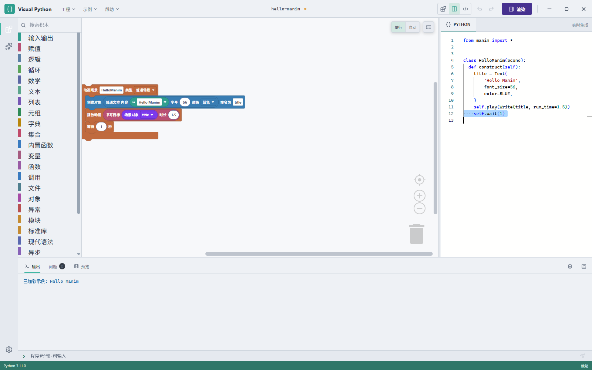

# Visual Python

Visual Python 是一个面向 Python 与 Manim 的桌面图形化编程工作台：用 Blockly 搭积木，实时生成 Python 代码，在本地运行、渲染和调试；同一套交互范式也覆盖 ESP32-S3、ESP32-WROOM 与 ESP8266-ESP12E 的 MicroPython 硬件编程。



## 功能

- **积木与代码双向对照**：Blockly 积木实时生成 Python/MicroPython 代码，代码视图与积木结构同步高亮。
- **Manim 创作**：内置 Manim 积木、场景渲染、视频预览、静帧导出、配音与声音克隆。
- **AI 编程助手**：支持 OpenAI 兼容接口与内嵌 Codex 智能体；AI 生成代码后经确定性转换器落地为真实积木，隔离校验通过后一次提交，可审查、可撤销。
- **AI 插件开发**：智能体可按需生成、验证并安装新积木插件；也支持导入外部插件 ZIP。
- **硬件工作台**：串口连接、MicroPython 固件烧录、设备文件管理、离线模拟器，以及逐板引脚校验。
- **本地优先**：Python 执行、Manim 渲染、硬件串口与设备文件都在本机完成；除语音合成等云服务外，核心功能可离线运行。

## 技术栈

- 桌面壳：Tauri 2（Rust 1.95）
- 前端：React 19、TypeScript、Vite 8
- 积木：Blockly 13（Zelos）
- 编辑器：Monaco Editor
- 语言服务：Pyright
- 动画：Manim
- 硬件：MicroPython / ESP32 / ESP8266

## 环境要求

- Windows 10/11（主要支持平台；其他平台未完整验证）
- Node.js 22+
- Rust 1.95.0（由 `rust-toolchain.toml` 固定）
- Python 3.11–3.14
- WebView2 Runtime（Windows 10/11 通常已预装）

Tauri CLI 通过项目依赖安装，不需要单独全局安装。

## 快速开始

```bash
npm install
npm run tauri dev
```

`npm run dev` 只启动 Vite 前端，不能单独打开完整桌面应用；请使用 `npm run tauri dev`。

## 构建

```bash
npm run tauri build
```

构建前会执行 `prepare:language-server`，把 `node.exe` 与 `node_modules/pyright` 复制到 `src-tauri/resources/language-server/`（该目录被 git 忽略）。仅构建前端可运行：

```bash
npm run build
```

## 测试

```bash
npm test

cd src-tauri
cargo test
cargo check
```

## 项目结构

```text
src/                 React UI、Blockly 积木、AI 助手、插件与硬件前端
src/agentV2/         AI 智能体、代码到积木转换、插件创作 IR
src/plugins/         插件注册、内置插件、外部插件源
src/hardware/        MicroPython 代码生成、板卡档案与硬件积木
src/examples/        示例工程
src-tauri/           Tauri/Rust 桌面服务、串口、固件与 Codex 集成
docs/                插件文档、Manim 文档、论文与设计记录
examples/            外部插件示例与打包产物
scripts/             构建、文档生成与语言服务准备脚本
```

## 插件

- Manim 是内置插件；NumPy、Pandas、Matplotlib 以外部插件形式提供。
- 外部插件格式、开发指南与打包方式见 [插件开发文档](docs/plugin-development/README.md)。
- Manim 积木与文档见 [Manim 插件文档](docs/manim-plugin/README.md)。
- 示例外部插件位于 `examples/external-plugins/`。

## 文档

- [Manim 插件使用说明](docs/manim-plugin/README.md)
- [插件开发指南](docs/plugin-development/README.md)
- [项目交接文档](docs/handoff/2026-10-24-visual-python-project-handoff.md)

## 已知限制

- 硬件功能以 Windows 串口链路为主；ESP32-S3、ESP32-WROOM 与 ESP8266-ESP12E 均已完成真机冒烟测试。
- AI 功能需要自行配置兼容的模型服务；仓库不包含任何 API Key。
- 部分文档与论文由脚本生成，生成后的二进制文件可能不与源码同步更新。
- 项目仍在活跃开发中，接口与插件格式可能变化。

## 许可证

本项目使用 [MIT License](LICENSE)。第三方组件与 vendored Codex 代码按各自许可证分发，声明见 [NOTICE](NOTICE)。
