# Visual Python Manim 插件使用说明

> 本说明基于当前项目中的实际 Manim 工具箱自动生成。每个积木只介绍一次；“常用”分类中的重复项归入其正式分类。

## 1. 使用前准备

1. 在应用底部选择项目支持的 Python 环境。
2. 确认 Manim 插件依赖检查通过；缺失时按提示安装 `manim`。
3. 在图形化模式中展开 **Manim** 工具箱。
4. 从“动画场景”开始搭建；对象、动画和参数积木不能脱离场景单独执行。
5. 使用顶部“渲染”生成 MP4 视频，或在 Manim 设置中选择 PNG 图片输出。

## 2. 先理解四种连接关系

- **场景/语句积木**：上下拼接，按从上到下的顺序执行。
- **场景对象积木**：创建文字、图形、坐标系等内容，通常先用“创建场景对象”保存名称。
- **动画积木**：输出动画效果，必须连接到“播放动画”“同时播放”或配音同步积木。
- **参数积木**：输出数字、方向、角度、颜色、坐标或列表，只能放入形状兼容的输入槽。

## 3. 积木速查目录

- [场景与流程 / 场景定义（1 个）](#场景与流程-场景定义)
- [场景与流程 / 播放控制（4 个）](#场景与流程-播放控制)
- [场景与流程 / 配音（2 个）](#场景与流程-配音)
- [场景与流程 / 音频（2 个）](#场景与流程-音频)
- [场景与流程 / 对象管理（5 个）](#场景与流程-对象管理)
- [场景与流程 / 三维相机（4 个）](#场景与流程-三维相机)
- [对象 / 文本与公式（4 个）](#对象-文本与公式)
- [对象 / 基础几何（12 个）](#对象-基础几何)
- [对象 / 线条与箭头（6 个）](#对象-线条与箭头)
- [对象 / 坐标对象（6 个）](#对象-坐标对象)
- [对象 / 坐标方法（5 个）](#对象-坐标方法)
- [对象 / 表格与矩阵（4 个）](#对象-表格与矩阵)
- [对象 / 标注与装饰（5 个）](#对象-标注与装饰)
- [对象 / 三维对象（8 个）](#对象-三维对象)
- [对象 / 复用与组合（4 个）](#对象-复用与组合)
- [动画效果 / 创建 / 消失（5 个）](#动画效果-创建-消失)
- [动画效果 / 淡入淡出（2 个）](#动画效果-淡入淡出)
- [动画效果 / 变换动画（4 个）](#动画效果-变换动画)
- [动画效果 / 属性动画（7 个）](#动画效果-属性动画)
- [动画效果 / 生长动画（6 个）](#动画效果-生长动画)
- [动画效果 / 强调动画（5 个）](#动画效果-强调动画)
- [坐标与数学工具（14 个）](#坐标与数学工具)
- [列表与批量结构（3 个）](#列表与批量结构)
- [动态绑定（10 个）](#动态绑定)
- [属性与样式 / 样式设置（7 个）](#属性与样式-样式设置)
- [属性与样式 / 位置变换（9 个）](#属性与样式-位置变换)

## 4. 全部积木说明（共 144 个）

## 场景与流程 / 场景定义

### 1. 动画场景

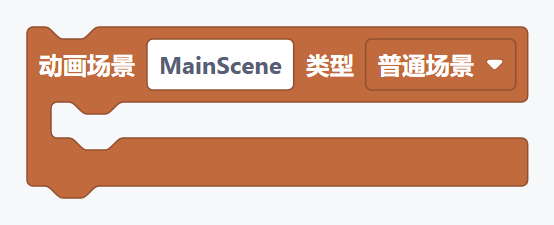

**说明：** 一个完整动画的入口。把创建对象、播放动画和等待等语句放入场景内部。

- **工具箱位置：** Manim / 场景与流程 / 场景定义
- **连接方式：** 语句/容器积木：接入场景执行区域，并在内部继续放置语句。
- **主要输入：** “执行内容”（任意兼容值）
- **直接配置：** “MainScene”、“普通场景”
- **积木标识：** `visual_python_manim_scene`

## 场景与流程 / 播放控制

### 2. 播放动画

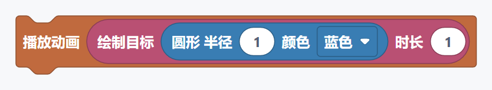

**说明：** 执行一个动画效果。创建、淡入和变形等效果需要连接到这里才能播放。

- **工具箱位置：** Manim / 场景与流程 / 播放控制
- **连接方式：** 语句积木：接入场景或其他容器的执行区域。
- **主要输入：** “动画”（动画效果）
- **直接配置：** 没有需要直接选择或填写的字段
- **积木标识：** `visual_python_manim_play`

### 3. 播放动画（时间与延迟）

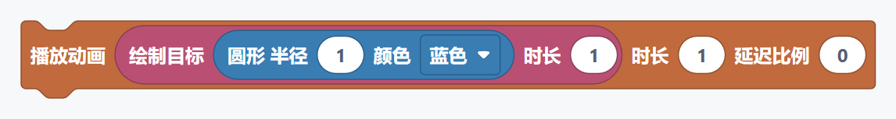

**说明：** 播放一个动画，并统一设置播放时间和动画内部对象的延迟比例。

- **工具箱位置：** Manim / 场景与流程 / 播放控制
- **连接方式：** 语句积木：接入场景或其他容器的执行区域。
- **主要输入：** “动画”（动画效果）、“播放时间”（数字）、“延迟比例”（数字）
- **直接配置：** 没有需要直接选择或填写的字段
- **积木标识：** `visual_python_manim_play_with_options`

### 4. 同时播放动画

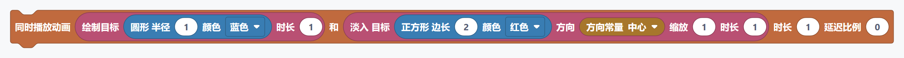

**说明：** 同时播放两个动画效果。延迟比例为零时同步开始。

- **工具箱位置：** Manim / 场景与流程 / 播放控制
- **连接方式：** 语句积木：接入场景或其他容器的执行区域。
- **主要输入：** “第一个对象/动画”（动画效果）、“第二个对象/动画”（动画效果）、“播放时间”（数字）、“延迟比例”（数字）
- **直接配置：** 没有需要直接选择或填写的字段
- **积木标识：** `visual_python_manim_play_two`

### 5. 等待

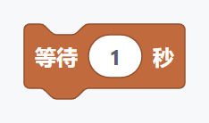

**说明：** 用于控制 Manim 场景中的“等待”流程，按它在场景执行区域中的先后顺序运行。

- **工具箱位置：** Manim / 场景与流程 / 播放控制
- **连接方式：** 语句积木：接入场景或其他容器的执行区域。
- **主要输入：** “等待秒数”（数字）
- **直接配置：** 没有需要直接选择或填写的字段
- **积木标识：** `visual_python_manim_wait`

## 场景与流程 / 配音

### 6. 播放配音

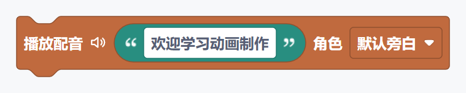

**说明：** 用于控制 Manim 场景中的“播放配音”流程，按它在场景执行区域中的先后顺序运行。

- **工具箱位置：** Manim / 场景与流程 / 配音
- **连接方式：** 语句积木：接入场景或其他容器的执行区域。
- **主要输入：** “文本内容”（文本）
- **直接配置：** “试听或停止此段配音”、“默认旁白”
- **积木标识：** `visual_python_manim_voiceover`

### 7. 配音并执行动画

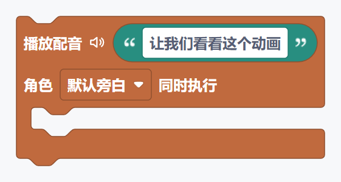

**说明：** 用于控制 Manim 场景中的“配音并执行动画”流程，按它在场景执行区域中的先后顺序运行。

- **工具箱位置：** Manim / 场景与流程 / 配音
- **连接方式：** 语句/容器积木：接入场景执行区域，并在内部继续放置语句。
- **主要输入：** “文本内容”（文本）、“执行内容”（任意兼容值）
- **直接配置：** “试听或停止此段配音”、“默认旁白”
- **积木标识：** `visual_python_manim_voiceover_with_animation`

## 场景与流程 / 音频

### 8. 播放音频

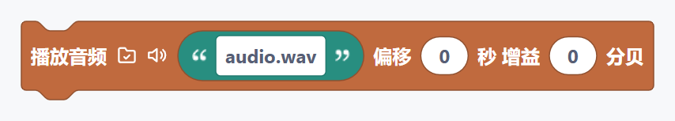

**说明：** 播放本地音乐、音效或录音。点击路径旁的文件夹图标可选择音频文件；路径也可以手动填写。需要等待音频结束时，请在后面连接等待积木。

- **工具箱位置：** Manim / 场景与流程 / 音频
- **连接方式：** 语句积木：接入场景或其他容器的执行区域。
- **主要输入：** “音频文件”（文本）、“开始偏移”（数字）、“音量增益”（数字）
- **直接配置：** “选择路径”、“试听或停止音频”
- **积木标识：** `visual_python_manim_play_local_audio`

### 9. 播放音频并执行动画

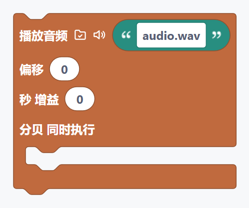

**说明：** 播放本地音频并同时执行内部动画。动画较短时，渲染前会根据音频时长自动补足等待。

- **工具箱位置：** Manim / 场景与流程 / 音频
- **连接方式：** 语句/容器积木：接入场景执行区域，并在内部继续放置语句。
- **主要输入：** “音频文件”（文本）、“开始偏移”（数字）、“音量增益”（数字）、“执行内容”（任意兼容值）
- **直接配置：** “选择路径”、“试听或停止音频”
- **积木标识：** `visual_python_manim_play_local_audio_with_animation`

## 场景与流程 / 对象管理

### 10. 添加对象

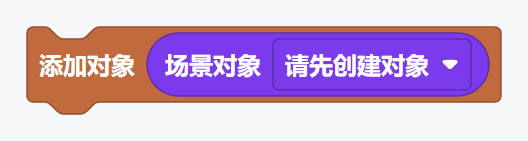

**说明：** 创建或处理“添加对象”场景对象。创建后的对象通常先保存到变量，再通过对象引用参与动画和布局。

- **工具箱位置：** Manim / 场景与流程 / 对象管理
- **连接方式：** 语句积木：接入场景或其他容器的执行区域。
- **主要输入：** “对象”（场景对象）
- **直接配置：** 没有需要直接选择或填写的字段
- **积木标识：** `visual_python_manim_add`

### 11. 同时添加两个对象


**说明：** 创建或处理“同时添加两个对象”场景对象。创建后的对象通常先保存到变量，再通过对象引用参与动画和布局。

- **工具箱位置：** Manim / 场景与流程 / 对象管理
- **连接方式：** 语句积木：接入场景或其他容器的执行区域。
- **主要输入：** “第一个对象/动画”（场景对象）、“第二个对象/动画”（场景对象）
- **直接配置：** 没有需要直接选择或填写的字段
- **积木标识：** `visual_python_manim_add_two`

### 12. 移除对象


**说明：** 创建或处理“移除对象”场景对象。创建后的对象通常先保存到变量，再通过对象引用参与动画和布局。

- **工具箱位置：** Manim / 场景与流程 / 对象管理
- **连接方式：** 语句积木：接入场景或其他容器的执行区域。
- **主要输入：** “对象”（场景对象）
- **直接配置：** 没有需要直接选择或填写的字段
- **积木标识：** `visual_python_manim_remove`

### 13. 同时移除两个对象

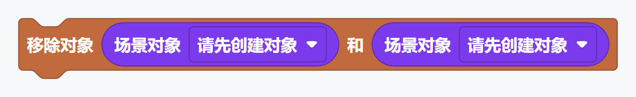

**说明：** 创建或处理“同时移除两个对象”场景对象。创建后的对象通常先保存到变量，再通过对象引用参与动画和布局。

- **工具箱位置：** Manim / 场景与流程 / 对象管理
- **连接方式：** 语句积木：接入场景或其他容器的执行区域。
- **主要输入：** “第一个对象/动画”（场景对象）、“第二个对象/动画”（场景对象）
- **直接配置：** 没有需要直接选择或填写的字段
- **积木标识：** `visual_python_manim_remove_two`

### 14. 清空场景

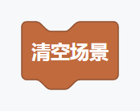

**说明：** 创建或处理“清空场景”场景对象。创建后的对象通常先保存到变量，再通过对象引用参与动画和布局。

- **工具箱位置：** Manim / 场景与流程 / 对象管理
- **连接方式：** 语句积木：接入场景或其他容器的执行区域。
- **主要输入：** 没有外接输入槽
- **直接配置：** 没有需要直接选择或填写的字段
- **积木标识：** `visual_python_manim_clear`

## 场景与流程 / 三维相机

### 15. 相机画面 目标

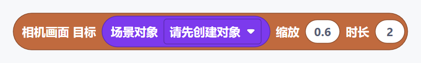

**说明：** 用于控制 Manim 场景中的“相机画面 目标”流程，按它在场景执行区域中的先后顺序运行。

- **工具箱位置：** Manim / 场景与流程 / 三维相机
- **连接方式：** 值积木：输出动画效果，连接到形状匹配的输入槽。
- **主要输入：** “目标对象”（场景对象）、“缩放”（数字）、“播放时间”（数字）
- **直接配置：** 没有需要直接选择或填写的字段
- **积木标识：** `visual_python_manim_camera_frame_animation`

### 16. 三维视角 垂直角

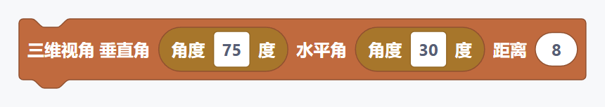

**说明：** 用于控制 Manim 场景中的“三维视角 垂直角”流程，按它在场景执行区域中的先后顺序运行。

- **工具箱位置：** Manim / 场景与流程 / 三维相机
- **连接方式：** 语句积木：接入场景或其他容器的执行区域。
- **主要输入：** “三维视角 垂直角”（角度 / 数字）、“水平角”（角度 / 数字）、“距离”（数字）
- **直接配置：** 没有需要直接选择或填写的字段
- **积木标识：** `visual_python_manim_3d_camera_orientation`

### 17. 三维移动相机 垂直角

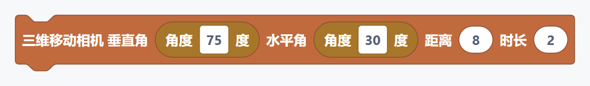

**说明：** 用于控制 Manim 场景中的“三维移动相机 垂直角”流程，按它在场景执行区域中的先后顺序运行。

- **工具箱位置：** Manim / 场景与流程 / 三维相机
- **连接方式：** 语句积木：接入场景或其他容器的执行区域。
- **主要输入：** “三维移动相机 垂直角”（角度 / 数字）、“水平角”（角度 / 数字）、“距离”（数字）、“播放时间”（数字）
- **直接配置：** 没有需要直接选择或填写的字段
- **积木标识：** `visual_python_manim_3d_move_camera`

### 18. 三维相机旋转

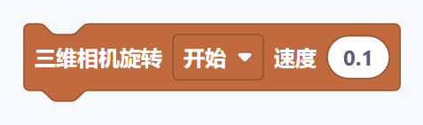

**说明：** 用于控制 Manim 场景中的“三维相机旋转”流程，按它在场景执行区域中的先后顺序运行。

- **工具箱位置：** Manim / 场景与流程 / 三维相机
- **连接方式：** 语句积木：接入场景或其他容器的执行区域。
- **主要输入：** “速度”（数字）
- **直接配置：** “开始”
- **积木标识：** `visual_python_manim_3d_ambient_rotation`

## 对象 / 文本与公式

### 19. 普通文本 内容

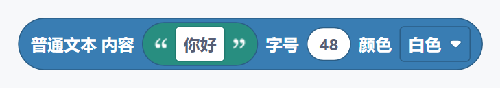

**说明：** 创建或处理“普通文本 内容”场景对象。创建后的对象通常先保存到变量，再通过对象引用参与动画和布局。

- **工具箱位置：** Manim / 对象 / 文本与公式
- **连接方式：** 值积木：输出场景对象，连接到形状匹配的输入槽。
- **主要输入：** “内容”（文本）、“字号”（数字）
- **直接配置：** “白色”
- **积木标识：** `visual_python_manim_plain_text_object`

### 20. 公式文本 内容

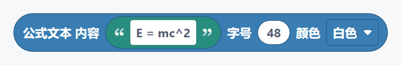

**说明：** 创建或处理“公式文本 内容”场景对象。创建后的对象通常先保存到变量，再通过对象引用参与动画和布局。

- **工具箱位置：** Manim / 对象 / 文本与公式
- **连接方式：** 值积木：输出场景对象，连接到形状匹配的输入槽。
- **主要输入：** “内容”（文本）、“字号”（数字）
- **直接配置：** “白色”
- **积木标识：** `visual_python_manim_tex_object`

### 21. 数学公式 内容

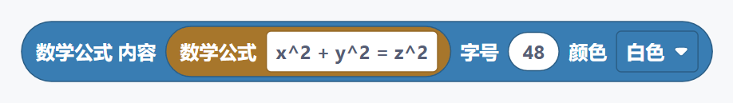

**说明：** 创建或处理“数学公式 内容”场景对象。创建后的对象通常先保存到变量，再通过对象引用参与动画和布局。

- **工具箱位置：** Manim / 对象 / 文本与公式
- **连接方式：** 值积木：输出场景对象，连接到形状匹配的输入槽。
- **主要输入：** “内容”（文本）、“字号”（数字）
- **直接配置：** “白色”
- **积木标识：** `visual_python_manim_mathtex_object`

### 22. 数学公式

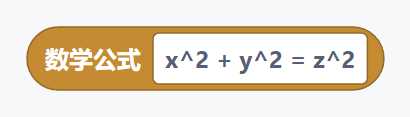

**说明：** 创建或处理“数学公式”场景对象。创建后的对象通常先保存到变量，再通过对象引用参与动画和布局。

- **工具箱位置：** Manim / 对象 / 文本与公式
- **连接方式：** 值积木：输出文本，连接到形状匹配的输入槽。
- **主要输入：** 没有外接输入槽
- **直接配置：** “x^2 + y^2 = z^2”
- **积木标识：** `visual_python_manim_formula_value`

## 对象 / 基础几何

### 23. 圆形 半径

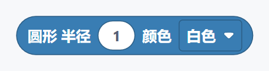

**说明：** 创建或处理“圆形 半径”场景对象。创建后的对象通常先保存到变量，再通过对象引用参与动画和布局。

- **工具箱位置：** Manim / 对象 / 基础几何
- **连接方式：** 值积木：输出场景对象，连接到形状匹配的输入槽。
- **主要输入：** “半径”（数字）
- **直接配置：** “白色”
- **积木标识：** `visual_python_manim_circle_object`

### 24. 正方形 边长

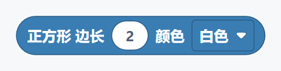

**说明：** 创建或处理“正方形 边长”场景对象。创建后的对象通常先保存到变量，再通过对象引用参与动画和布局。

- **工具箱位置：** Manim / 对象 / 基础几何
- **连接方式：** 值积木：输出场景对象，连接到形状匹配的输入槽。
- **主要输入：** “正方形 边长”（数字）
- **直接配置：** “白色”
- **积木标识：** `visual_python_manim_square_object`

### 25. 矩形 宽

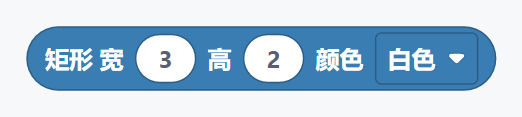

**说明：** 创建或处理“矩形 宽”场景对象。创建后的对象通常先保存到变量，再通过对象引用参与动画和布局。

- **工具箱位置：** Manim / 对象 / 基础几何
- **连接方式：** 值积木：输出场景对象，连接到形状匹配的输入槽。
- **主要输入：** “宽度”（数字）、“高度”（数字）
- **直接配置：** “白色”
- **积木标识：** `visual_python_manim_rectangle_object`

### 26. 点 位置

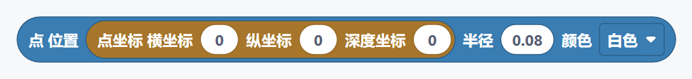

**说明：** 创建或处理“点 位置”场景对象。创建后的对象通常先保存到变量，再通过对象引用参与动画和布局。

- **工具箱位置：** Manim / 对象 / 基础几何
- **连接方式：** 值积木：输出场景对象，连接到形状匹配的输入槽。
- **主要输入：** “坐标点”（方向、坐标或向量 / 数字）、“半径”（数字）
- **直接配置：** “白色”
- **积木标识：** `visual_python_manim_dot_object`

### 27. 三角形 颜色

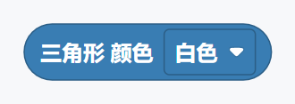

**说明：** 创建或处理“三角形 颜色”场景对象。创建后的对象通常先保存到变量，再通过对象引用参与动画和布局。

- **工具箱位置：** Manim / 对象 / 基础几何
- **连接方式：** 值积木：输出场景对象，连接到形状匹配的输入槽。
- **主要输入：** 没有外接输入槽
- **直接配置：** “白色”
- **积木标识：** `visual_python_manim_triangle_object`

### 28. 正多边形 边数

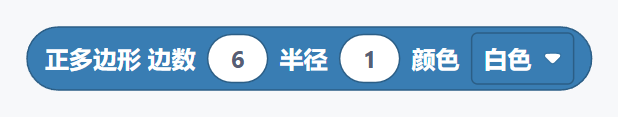

**说明：** 创建或处理“正多边形 边数”场景对象。创建后的对象通常先保存到变量，再通过对象引用参与动画和布局。

- **工具箱位置：** Manim / 对象 / 基础几何
- **连接方式：** 值积木：输出场景对象，连接到形状匹配的输入槽。
- **主要输入：** “正多边形 边数”（数字）、“半径”（数字）
- **直接配置：** “白色”
- **积木标识：** `visual_python_manim_regular_polygon_object`

### 29. 多边形 顶点

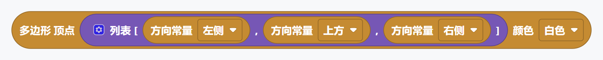

**说明：** 创建或处理“多边形 顶点”场景对象。创建后的对象通常先保存到变量，再通过对象引用参与动画和布局。

- **工具箱位置：** Manim / 对象 / 基础几何
- **连接方式：** 值积木：输出场景对象，连接到形状匹配的输入槽。
- **主要输入：** “坐标点列表”（ManimPointArguments）
- **直接配置：** “白色”
- **积木标识：** `visual_python_manim_polygon_points_object`

### 30. 圆角矩形 宽

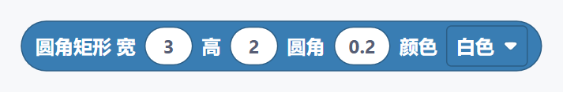

**说明：** 创建或处理“圆角矩形 宽”场景对象。创建后的对象通常先保存到变量，再通过对象引用参与动画和布局。

- **工具箱位置：** Manim / 对象 / 基础几何
- **连接方式：** 值积木：输出场景对象，连接到形状匹配的输入槽。
- **主要输入：** “宽度”（数字）、“高度”（数字）、“圆角”（数字）
- **直接配置：** “白色”
- **积木标识：** `visual_python_manim_rounded_rectangle_object`

### 31. 椭圆 宽

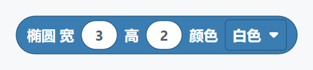

**说明：** 创建或处理“椭圆 宽”场景对象。创建后的对象通常先保存到变量，再通过对象引用参与动画和布局。

- **工具箱位置：** Manim / 对象 / 基础几何
- **连接方式：** 值积木：输出场景对象，连接到形状匹配的输入槽。
- **主要输入：** “宽度”（数字）、“高度”（数字）
- **直接配置：** “白色”
- **积木标识：** `visual_python_manim_ellipse_object`

### 32. 圆弧 半径

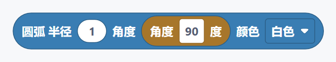

**说明：** 创建或处理“圆弧 半径”场景对象。创建后的对象通常先保存到变量，再通过对象引用参与动画和布局。

- **工具箱位置：** Manim / 对象 / 基础几何
- **连接方式：** 值积木：输出场景对象，连接到形状匹配的输入槽。
- **主要输入：** “半径”（数字）、“角度”（角度 / 数字）
- **直接配置：** “白色”
- **积木标识：** `visual_python_manim_arc_object`

### 33. 扇形 外半径

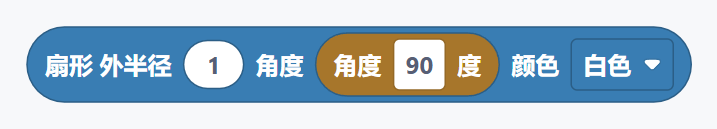

**说明：** 创建或处理“扇形 外半径”场景对象。创建后的对象通常先保存到变量，再通过对象引用参与动画和布局。

- **工具箱位置：** Manim / 对象 / 基础几何
- **连接方式：** 值积木：输出场景对象，连接到形状匹配的输入槽。
- **主要输入：** “扇形 外半径”（数字）、“角度”（角度 / 数字）
- **直接配置：** “白色”
- **积木标识：** `visual_python_manim_sector_object`

### 34. 圆环 内半径

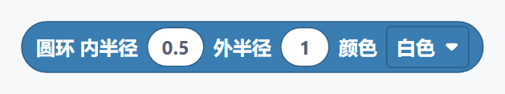

**说明：** 创建或处理“圆环 内半径”场景对象。创建后的对象通常先保存到变量，再通过对象引用参与动画和布局。

- **工具箱位置：** Manim / 对象 / 基础几何
- **连接方式：** 值积木：输出场景对象，连接到形状匹配的输入槽。
- **主要输入：** “圆环 内半径”（数字）、“外半径”（数字）
- **直接配置：** “白色”
- **积木标识：** `visual_python_manim_annulus_object`

## 对象 / 线条与箭头

### 35. 直线 起点

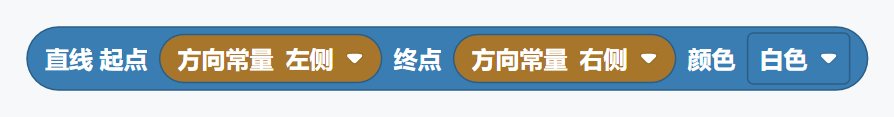

**说明：** 创建或处理“直线 起点”场景对象。创建后的对象通常先保存到变量，再通过对象引用参与动画和布局。

- **工具箱位置：** Manim / 对象 / 线条与箭头
- **连接方式：** 值积木：输出场景对象，连接到形状匹配的输入槽。
- **主要输入：** “起点”（方向、坐标或向量 / 数字）、“终点”（方向、坐标或向量 / 数字）
- **直接配置：** “白色”
- **积木标识：** `visual_python_manim_line_segment_object`

### 36. 虚线 起点

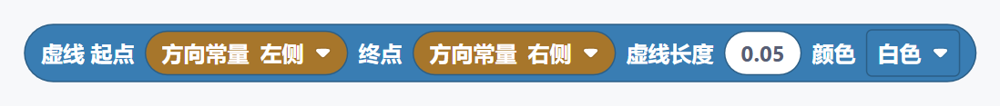

**说明：** 创建或处理“虚线 起点”场景对象。创建后的对象通常先保存到变量，再通过对象引用参与动画和布局。

- **工具箱位置：** Manim / 对象 / 线条与箭头
- **连接方式：** 值积木：输出场景对象，连接到形状匹配的输入槽。
- **主要输入：** “起点”（方向、坐标或向量 / 数字）、“终点”（方向、坐标或向量 / 数字）、“虚线长度”（数字）
- **直接配置：** “白色”
- **积木标识：** `visual_python_manim_dashed_line_object`

### 37. 箭头 起点

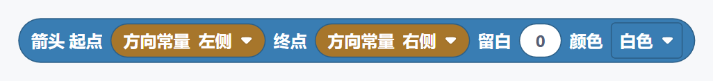

**说明：** 创建或处理“箭头 起点”场景对象。创建后的对象通常先保存到变量，再通过对象引用参与动画和布局。

- **工具箱位置：** Manim / 对象 / 线条与箭头
- **连接方式：** 值积木：输出场景对象，连接到形状匹配的输入槽。
- **主要输入：** “起点”（方向、坐标或向量 / 数字）、“终点”（方向、坐标或向量 / 数字）、“间距”（数字）
- **直接配置：** “白色”
- **积木标识：** `visual_python_manim_arrow_object`

### 38. 双箭头 起点

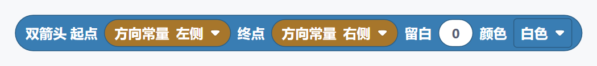

**说明：** 创建或处理“双箭头 起点”场景对象。创建后的对象通常先保存到变量，再通过对象引用参与动画和布局。

- **工具箱位置：** Manim / 对象 / 线条与箭头
- **连接方式：** 值积木：输出场景对象，连接到形状匹配的输入槽。
- **主要输入：** “起点”（方向、坐标或向量 / 数字）、“终点”（方向、坐标或向量 / 数字）、“间距”（数字）
- **直接配置：** “白色”
- **积木标识：** `visual_python_manim_double_arrow_object`

### 39. 曲线箭头 起点

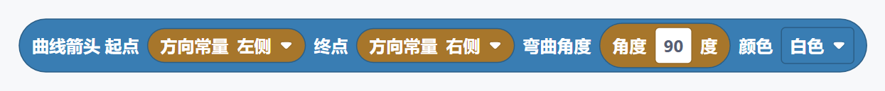

**说明：** 创建或处理“曲线箭头 起点”场景对象。创建后的对象通常先保存到变量，再通过对象引用参与动画和布局。

- **工具箱位置：** Manim / 对象 / 线条与箭头
- **连接方式：** 值积木：输出场景对象，连接到形状匹配的输入槽。
- **主要输入：** “起点”（方向、坐标或向量 / 数字）、“终点”（方向、坐标或向量 / 数字）、“角度”（角度 / 数字）
- **直接配置：** “白色”
- **积木标识：** `visual_python_manim_curved_arrow_object`

### 40. 向量 方向

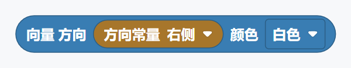

**说明：** 创建或处理“向量 方向”场景对象。创建后的对象通常先保存到变量，再通过对象引用参与动画和布局。

- **工具箱位置：** Manim / 对象 / 线条与箭头
- **连接方式：** 值积木：输出场景对象，连接到形状匹配的输入槽。
- **主要输入：** “方向”（方向、坐标或向量 / 数字）
- **直接配置：** “白色”
- **积木标识：** `visual_python_manim_vector_object`

## 对象 / 坐标对象

### 41. 数轴 数值范围

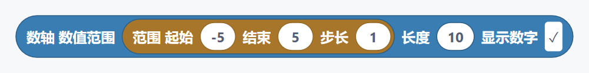

**说明：** 创建或处理“数轴 数值范围”场景对象。创建后的对象通常先保存到变量，再通过对象引用参与动画和布局。

- **工具箱位置：** Manim / 对象 / 坐标对象
- **连接方式：** 值积木：输出场景对象，连接到形状匹配的输入槽。
- **主要输入：** “横坐标范围”（ManimRange）、“长度”（数字）
- **直接配置：** “true”
- **积木标识：** `visual_python_manim_number_line_object`

### 42. 二维坐标系 横轴范围

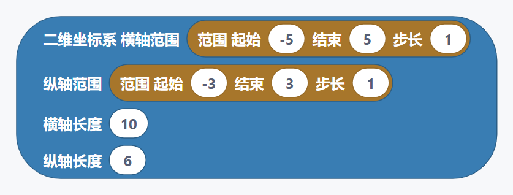

**说明：** 创建二维坐标系。范围控制刻度区间，长度控制画面中的显示尺寸。

- **工具箱位置：** Manim / 对象 / 坐标对象
- **连接方式：** 值积木：输出场景对象，连接到形状匹配的输入槽。
- **主要输入：** “横坐标范围”（ManimRange）、“纵坐标范围”（ManimRange）、“横轴长度”（数字）、“纵轴长度”（数字）
- **直接配置：** 没有需要直接选择或填写的字段
- **积木标识：** `visual_python_manim_axes_object`

### 43. 平面网格 横轴范围

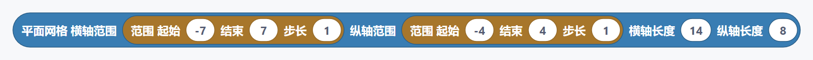

**说明：** 创建或处理“平面网格 横轴范围”场景对象。创建后的对象通常先保存到变量，再通过对象引用参与动画和布局。

- **工具箱位置：** Manim / 对象 / 坐标对象
- **连接方式：** 值积木：输出场景对象，连接到形状匹配的输入槽。
- **主要输入：** “横坐标范围”（ManimRange）、“纵坐标范围”（ManimRange）、“横轴长度”（数字）、“纵轴长度”（数字）
- **直接配置：** 没有需要直接选择或填写的字段
- **积木标识：** `visual_python_manim_number_plane_object`

### 44. 复平面 横轴范围

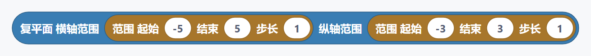

**说明：** 创建或处理“复平面 横轴范围”场景对象。创建后的对象通常先保存到变量，再通过对象引用参与动画和布局。

- **工具箱位置：** Manim / 对象 / 坐标对象
- **连接方式：** 值积木：输出场景对象，连接到形状匹配的输入槽。
- **主要输入：** “横坐标范围”（ManimRange）、“纵坐标范围”（ManimRange）
- **直接配置：** 没有需要直接选择或填写的字段
- **积木标识：** `visual_python_manim_complex_plane_object`

### 45. 极坐标平面 最大半径

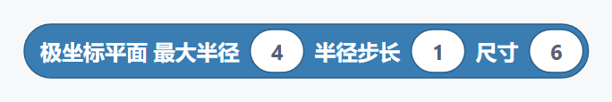

**说明：** 创建或处理“极坐标平面 最大半径”场景对象。创建后的对象通常先保存到变量，再通过对象引用参与动画和布局。

- **工具箱位置：** Manim / 对象 / 坐标对象
- **连接方式：** 值积木：输出场景对象，连接到形状匹配的输入槽。
- **主要输入：** “极坐标平面 最大半径”（数字）、“半径步长”（数字）、“尺寸”（数字）
- **直接配置：** 没有需要直接选择或填写的字段
- **积木标识：** `visual_python_manim_polar_plane_object`

### 46. 三维坐标系 横轴范围

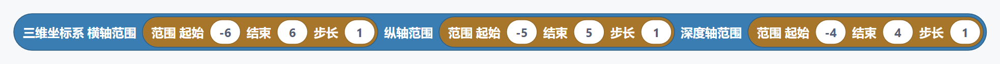

**说明：** 创建三维坐标系，需要放在三维场景中使用。

- **工具箱位置：** Manim / 对象 / 坐标对象
- **连接方式：** 值积木：输出场景对象，连接到形状匹配的输入槽。
- **主要输入：** “横坐标范围”（ManimRange）、“纵坐标范围”（ManimRange）、“竖坐标范围”（ManimRange）
- **直接配置：** 没有需要直接选择或填写的字段
- **积木标识：** `visual_python_manim_three_d_axes_object`

## 对象 / 坐标方法

### 47. 绘制函数图像

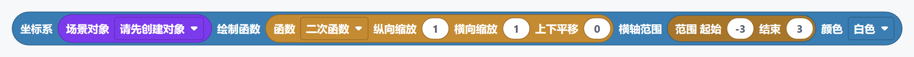

**说明：** 使用已创建的坐标系绘制函数曲线。请先创建并命名坐标系。

- **工具箱位置：** Manim / 对象 / 坐标方法
- **连接方式：** 值积木：输出场景对象，连接到形状匹配的输入槽。
- **主要输入：** “坐标系”（场景对象）、“函数”（ManimFunction）、“横坐标范围”（ManimRange）
- **直接配置：** “白色”
- **积木标识：** `visual_python_manim_axes_plot`

### 48. 坐标转画面点

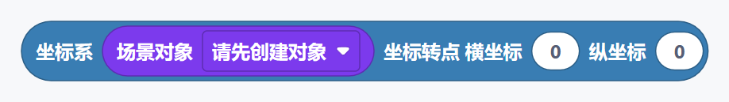

**说明：** 把数学坐标转换成画面中的位置点。

- **工具箱位置：** Manim / 对象 / 坐标方法
- **连接方式：** 值积木：输出值，连接到形状匹配的输入槽。
- **主要输入：** “坐标系”（场景对象）、“横坐标”（数字）、“纵坐标”（数字）
- **直接配置：** 没有需要直接选择或填写的字段
- **积木标识：** `visual_python_manim_axes_c2p`

### 49. 画面点转坐标

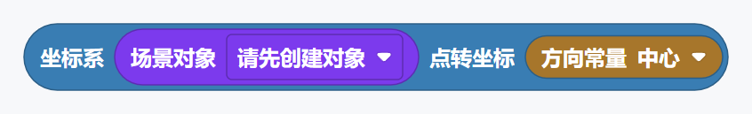

**说明：** 把画面中的位置点转换成该坐标系内的数学坐标。

- **工具箱位置：** Manim / 对象 / 坐标方法
- **连接方式：** 值积木：输出值，连接到形状匹配的输入槽。
- **主要输入：** “坐标系”（场景对象）、“坐标点”（方向、坐标或向量 / 数字）
- **直接配置：** 没有需要直接选择或填写的字段
- **积木标识：** `visual_python_manim_axes_p2c`

### 50. 创建坐标轴标签

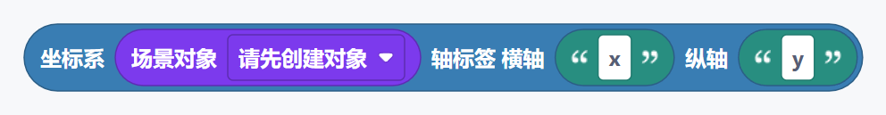

**说明：** 为已创建的坐标系生成横轴和纵轴标签。

- **工具箱位置：** Manim / 对象 / 坐标方法
- **连接方式：** 值积木：输出场景对象，连接到形状匹配的输入槽。
- **主要输入：** “坐标系”（场景对象）、“横轴标签”（文本）、“纵轴标签”（文本）
- **直接配置：** 没有需要直接选择或填写的字段
- **积木标识：** `visual_python_manim_axis_labels`

### 51. 创建函数面积

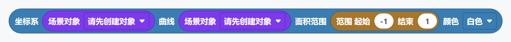

**说明：** 填充函数曲线与横轴之间的区域。坐标系和曲线必须引用同一套坐标系。

- **工具箱位置：** Manim / 对象 / 坐标方法
- **连接方式：** 值积木：输出场景对象，连接到形状匹配的输入槽。
- **主要输入：** “坐标系”（场景对象）、“函数图像”（场景对象）、“横坐标范围”（ManimRange）
- **直接配置：** “白色”
- **积木标识：** `visual_python_manim_axes_area`

## 对象 / 表格与矩阵

### 52. 表格对象

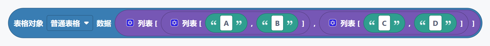

**说明：** 创建或处理“表格对象”场景对象。创建后的对象通常先保存到变量，再通过对象引用参与动画和布局。

- **工具箱位置：** Manim / 对象 / 表格与矩阵
- **连接方式：** 值积木：输出场景对象，连接到形状匹配的输入槽。
- **主要输入：** “数据”（任意兼容值）
- **直接配置：** “普通表格”
- **积木标识：** `visual_python_manim_table_object`

### 53. 矩阵对象


**说明：** 创建或处理“矩阵对象”场景对象。创建后的对象通常先保存到变量，再通过对象引用参与动画和布局。

- **工具箱位置：** Manim / 对象 / 表格与矩阵
- **连接方式：** 值积木：输出场景对象，连接到形状匹配的输入槽。
- **主要输入：** “数据”（任意兼容值）
- **直接配置：** “普通矩阵”
- **积木标识：** `visual_python_manim_matrix_object`

### 54. 行列式矩阵 数据


**说明：** 创建或处理“行列式矩阵 数据”场景对象。创建后的对象通常先保存到变量，再通过对象引用参与动画和布局。

- **工具箱位置：** Manim / 对象 / 表格与矩阵
- **连接方式：** 值积木：输出场景对象，连接到形状匹配的输入槽。
- **主要输入：** “数据”（任意兼容值）
- **直接配置：** 没有需要直接选择或填写的字段
- **积木标识：** `visual_python_manim_determinant_object`

### 55. 表格


**说明：** 创建或处理“表格”场景对象。创建后的对象通常先保存到变量，再通过对象引用参与动画和布局。

- **工具箱位置：** Manim / 对象 / 表格与矩阵
- **连接方式：** 值积木：输出场景对象，连接到形状匹配的输入槽。
- **主要输入：** “表格”（场景对象）、“行”（数字）、“列”（数字）
- **直接配置：** “白色”
- **积木标识：** `visual_python_manim_table_highlight_cell`

## 对象 / 标注与装饰

### 56. 大括号 目标


**说明：** 创建或处理“大括号 目标”场景对象。创建后的对象通常先保存到变量，再通过对象引用参与动画和布局。

- **工具箱位置：** Manim / 对象 / 标注与装饰
- **连接方式：** 值积木：输出场景对象，连接到形状匹配的输入槽。
- **主要输入：** “目标对象”（场景对象）、“方向”（方向、坐标或向量 / 数字）
- **直接配置：** 没有需要直接选择或填写的字段
- **积木标识：** `visual_python_manim_brace`

### 57. 大括号标注 目标


**说明：** 创建或处理“大括号标注 目标”场景对象。创建后的对象通常先保存到变量，再通过对象引用参与动画和布局。

- **工具箱位置：** Manim / 对象 / 标注与装饰
- **连接方式：** 值积木：输出场景对象，连接到形状匹配的输入槽。
- **主要输入：** “目标对象”（场景对象）、“标签”（文本）、“方向”（方向、坐标或向量 / 数字）
- **直接配置：** 没有需要直接选择或填写的字段
- **积木标识：** `visual_python_manim_brace_label`

### 58. 环绕矩形 目标


**说明：** 创建或处理“环绕矩形 目标”场景对象。创建后的对象通常先保存到变量，再通过对象引用参与动画和布局。

- **工具箱位置：** Manim / 对象 / 标注与装饰
- **连接方式：** 值积木：输出场景对象，连接到形状匹配的输入槽。
- **主要输入：** “目标对象”（场景对象）、“间距”（数字）
- **直接配置：** “白色”
- **积木标识：** `visual_python_manim_surrounding_rectangle`

### 59. 角度标注 直线一


**说明：** 创建或处理“角度标注 直线一”场景对象。创建后的对象通常先保存到变量，再通过对象引用参与动画和布局。

- **工具箱位置：** Manim / 对象 / 标注与装饰
- **连接方式：** 值积木：输出场景对象，连接到形状匹配的输入槽。
- **主要输入：** “角度标注 直线一”（场景对象）、“直线二”（场景对象）、“半径”（数字）
- **直接配置：** “白色”
- **积木标识：** `visual_python_manim_angle`

### 60. 直角标注 直线一


**说明：** 创建或处理“直角标注 直线一”场景对象。创建后的对象通常先保存到变量，再通过对象引用参与动画和布局。

- **工具箱位置：** Manim / 对象 / 标注与装饰
- **连接方式：** 值积木：输出场景对象，连接到形状匹配的输入槽。
- **主要输入：** “直角标注 直线一”（场景对象）、“直线二”（场景对象）、“长度”（数字）
- **直接配置：** “白色”
- **积木标识：** `visual_python_manim_right_angle`

## 对象 / 三维对象

### 61. 球体 半径


**说明：** 创建或处理“球体 半径”场景对象。创建后的对象通常先保存到变量，再通过对象引用参与动画和布局。

- **工具箱位置：** Manim / 对象 / 三维对象
- **连接方式：** 值积木：输出场景对象，连接到形状匹配的输入槽。
- **主要输入：** “半径”（数字）、“不透明度”（数字）
- **直接配置：** “白色”
- **积木标识：** `visual_python_manim_sphere_object`

### 62. 立方体 边长


**说明：** 创建或处理“立方体 边长”场景对象。创建后的对象通常先保存到变量，再通过对象引用参与动画和布局。

- **工具箱位置：** Manim / 对象 / 三维对象
- **连接方式：** 值积木：输出场景对象，连接到形状匹配的输入槽。
- **主要输入：** “立方体 边长”（数字）、“不透明度”（数字）
- **直接配置：** “白色”
- **积木标识：** `visual_python_manim_cube_object`

### 63. 圆锥 底半径


**说明：** 创建或处理“圆锥 底半径”场景对象。创建后的对象通常先保存到变量，再通过对象引用参与动画和布局。

- **工具箱位置：** Manim / 对象 / 三维对象
- **连接方式：** 值积木：输出场景对象，连接到形状匹配的输入槽。
- **主要输入：** “圆锥 底半径”（数字）、“高度”（数字）、“方向”（方向、坐标或向量 / 数字）
- **直接配置：** “true”、“白色”
- **积木标识：** `visual_python_manim_cone_object`

### 64. 圆柱 半径


**说明：** 创建或处理“圆柱 半径”场景对象。创建后的对象通常先保存到变量，再通过对象引用参与动画和布局。

- **工具箱位置：** Manim / 对象 / 三维对象
- **连接方式：** 值积木：输出场景对象，连接到形状匹配的输入槽。
- **主要输入：** “半径”（数字）、“高度”（数字）、“方向”（方向、坐标或向量 / 数字）
- **直接配置：** “true”、“白色”
- **积木标识：** `visual_python_manim_cylinder_object`

### 65. 棱柱 尺寸


**说明：** 创建或处理“棱柱 尺寸”场景对象。创建后的对象通常先保存到变量，再通过对象引用参与动画和布局。

- **工具箱位置：** Manim / 对象 / 三维对象
- **连接方式：** 值积木：输出场景对象，连接到形状匹配的输入槽。
- **主要输入：** “棱柱 尺寸”（ManimDimensions）、“不透明度”（数字）
- **直接配置：** “白色”
- **积木标识：** `visual_python_manim_prism_object`

### 66. 圆环面 主半径


**说明：** 创建或处理“圆环面 主半径”场景对象。创建后的对象通常先保存到变量，再通过对象引用参与动画和布局。

- **工具箱位置：** Manim / 对象 / 三维对象
- **连接方式：** 值积木：输出场景对象，连接到形状匹配的输入槽。
- **主要输入：** “圆环面 主半径”（数字）、“管半径”（数字）、“不透明度”（数字）
- **直接配置：** “白色”
- **积木标识：** `visual_python_manim_torus_object`

### 67. 参数曲面 函数


**说明：** 根据两个参数生成三维曲面。精度越高越平滑，但渲染时间也越长。

- **工具箱位置：** Manim / 对象 / 三维对象
- **连接方式：** 值积木：输出场景对象，连接到形状匹配的输入槽。
- **主要输入：** “函数”（ManimSurfaceFunction）、“横向参数范围”（ManimRange）、“纵向参数范围”（ManimRange）、“精度”（数字）
- **直接配置：** “白色”
- **积木标识：** `visual_python_manim_parametric_surface`

### 68. 三维箭头 起点


**说明：** 创建或处理“三维箭头 起点”场景对象。创建后的对象通常先保存到变量，再通过对象引用参与动画和布局。

- **工具箱位置：** Manim / 对象 / 三维对象
- **连接方式：** 值积木：输出场景对象，连接到形状匹配的输入槽。
- **主要输入：** “起点”（方向、坐标或向量 / 数字）、“终点”（方向、坐标或向量 / 数字）、“线宽”（数字）、“高度”（数字）、“底半径”（数字）
- **直接配置：** “白色”
- **积木标识：** `visual_python_manim_arrow3d_object`

## 对象 / 复用与组合

### 69. 组合对象


**说明：** 创建或处理“组合对象”场景对象。创建后的对象通常先保存到变量，再通过对象引用参与动画和布局。

- **工具箱位置：** Manim / 对象 / 复用与组合
- **连接方式：** 值积木：输出场景对象，连接到形状匹配的输入槽。
- **主要输入：** “第一个对象/动画”（场景对象）、“第二个对象/动画”（场景对象）
- **直接配置：** 没有需要直接选择或填写的字段
- **积木标识：** `visual_python_manim_group_object`

### 70. 创建场景对象


**说明：** 创建对象并保存名称，之后可通过“场景对象”积木重复使用。

- **工具箱位置：** Manim / 对象 / 复用与组合
- **连接方式：** 语句积木：接入场景或其他容器的执行区域。
- **主要输入：** “对象”（场景对象）
- **直接配置：** “obj”
- **积木标识：** `visual_python_manim_assign`

### 71. 创建并添加场景对象


**说明：** 创建并命名对象，同时立即把它添加到画面中。

- **工具箱位置：** Manim / 对象 / 复用与组合
- **连接方式：** 语句积木：接入场景或其他容器的执行区域。
- **主要输入：** “对象”（场景对象）
- **直接配置：** “obj”
- **积木标识：** `visual_python_manim_assign_add`

### 72. 场景对象


**说明：** 引用已经创建并命名的对象。下拉列表会根据当前位置筛选可用对象。

- **工具箱位置：** Manim / 对象 / 复用与组合
- **连接方式：** 值积木：输出场景对象，连接到形状匹配的输入槽。
- **主要输入：** 没有外接输入槽
- **直接配置：** “请先创建对象”
- **积木标识：** `visual_python_manim_object_ref`

## 动画效果 / 创建 / 消失

### 73. 绘制目标


**说明：** 生成“绘制目标”动画效果。它本身不会立即播放，需要连接到“播放动画”等播放控制积木。

- **工具箱位置：** Manim / 动画效果 / 创建 / 消失
- **连接方式：** 值积木：输出动画效果，连接到形状匹配的输入槽。
- **主要输入：** “对象”（场景对象）、“播放时间”（数字）
- **直接配置：** 没有需要直接选择或填写的字段
- **积木标识：** `visual_python_manim_create_object_animation`

### 74. 书写目标


**说明：** 生成“书写目标”动画效果。它本身不会立即播放，需要连接到“播放动画”等播放控制积木。

- **工具箱位置：** Manim / 动画效果 / 创建 / 消失
- **连接方式：** 值积木：输出动画效果，连接到形状匹配的输入槽。
- **主要输入：** “对象”（场景对象）、“播放时间”（数字）
- **直接配置：** 没有需要直接选择或填写的字段
- **积木标识：** `visual_python_manim_write_animation`

### 75. 反向绘制目标


**说明：** 生成“反向绘制目标”动画效果。它本身不会立即播放，需要连接到“播放动画”等播放控制积木。

- **工具箱位置：** Manim / 动画效果 / 创建 / 消失
- **连接方式：** 值积木：输出动画效果，连接到形状匹配的输入槽。
- **主要输入：** “对象”（场景对象）、“播放时间”（数字）
- **直接配置：** 没有需要直接选择或填写的字段
- **积木标识：** `visual_python_manim_uncreate_animation`

### 76. 反向书写目标


**说明：** 生成“反向书写目标”动画效果。它本身不会立即播放，需要连接到“播放动画”等播放控制积木。

- **工具箱位置：** Manim / 动画效果 / 创建 / 消失
- **连接方式：** 值积木：输出动画效果，连接到形状匹配的输入槽。
- **主要输入：** “对象”（场景对象）、“播放时间”（数字）
- **直接配置：** 没有需要直接选择或填写的字段
- **积木标识：** `visual_python_manim_unwrite_animation`

### 77. 先描边再填充 目标


**说明：** 生成“先描边再填充 目标”动画效果。它本身不会立即播放，需要连接到“播放动画”等播放控制积木。

- **工具箱位置：** Manim / 动画效果 / 创建 / 消失
- **连接方式：** 值积木：输出动画效果，连接到形状匹配的输入槽。
- **主要输入：** “对象”（场景对象）、“播放时间”（数字）
- **直接配置：** 没有需要直接选择或填写的字段
- **积木标识：** `visual_python_manim_draw_border_then_fill_animation`

## 动画效果 / 淡入淡出

### 78. 淡入 目标


**说明：** 生成“淡入 目标”动画效果。它本身不会立即播放，需要连接到“播放动画”等播放控制积木。

- **工具箱位置：** Manim / 动画效果 / 淡入淡出
- **连接方式：** 值积木：输出动画效果，连接到形状匹配的输入槽。
- **主要输入：** “对象”（场景对象）、“方向”（方向、坐标或向量 / 数字）、“缩放”（数字）、“播放时间”（数字）
- **直接配置：** 没有需要直接选择或填写的字段
- **积木标识：** `visual_python_manim_fade_in_animation`

### 79. 淡出 目标


**说明：** 生成“淡出 目标”动画效果。它本身不会立即播放，需要连接到“播放动画”等播放控制积木。

- **工具箱位置：** Manim / 动画效果 / 淡入淡出
- **连接方式：** 值积木：输出动画效果，连接到形状匹配的输入槽。
- **主要输入：** “对象”（场景对象）、“方向”（方向、坐标或向量 / 数字）、“缩放”（数字）、“播放时间”（数字）
- **直接配置：** 没有需要直接选择或填写的字段
- **积木标识：** `visual_python_manim_fade_out_animation`

## 动画效果 / 变换动画

### 80. 变形 从


**说明：** 生成“变形 从”动画效果。它本身不会立即播放，需要连接到“播放动画”等播放控制积木。

- **工具箱位置：** Manim / 动画效果 / 变换动画
- **连接方式：** 值积木：输出动画效果，连接到形状匹配的输入槽。
- **主要输入：** “源对象”（场景对象）、“目标对象”（场景对象）、“播放时间”（数字）
- **直接配置：** 没有需要直接选择或填写的字段
- **积木标识：** `visual_python_manim_transform_to_animation`

### 81. 替换变形 从


**说明：** 生成“替换变形 从”动画效果。它本身不会立即播放，需要连接到“播放动画”等播放控制积木。

- **工具箱位置：** Manim / 动画效果 / 变换动画
- **连接方式：** 值积木：输出动画效果，连接到形状匹配的输入槽。
- **主要输入：** “源对象”（场景对象）、“目标对象”（场景对象）、“播放时间”（数字）
- **直接配置：** 没有需要直接选择或填写的字段
- **积木标识：** `visual_python_manim_replacement_transform_animation`

### 82. 复制后变形 从


**说明：** 生成“复制后变形 从”动画效果。它本身不会立即播放，需要连接到“播放动画”等播放控制积木。

- **工具箱位置：** Manim / 动画效果 / 变换动画
- **连接方式：** 值积木：输出动画效果，连接到形状匹配的输入槽。
- **主要输入：** “源对象”（场景对象）、“目标对象”（场景对象）、“播放时间”（数字）
- **直接配置：** 没有需要直接选择或填写的字段
- **积木标识：** `visual_python_manim_transform_from_copy_animation`

### 83. 淡化变形 从


**说明：** 生成“淡化变形 从”动画效果。它本身不会立即播放，需要连接到“播放动画”等播放控制积木。

- **工具箱位置：** Manim / 动画效果 / 变换动画
- **连接方式：** 值积木：输出动画效果，连接到形状匹配的输入槽。
- **主要输入：** “源对象”（场景对象）、“目标对象”（场景对象）、“播放时间”（数字）
- **直接配置：** 没有需要直接选择或填写的字段
- **积木标识：** `visual_python_manim_fade_transform_animation`

## 动画效果 / 属性动画

### 84. 移动动画 对象


**说明：** 生成“移动动画 对象”动画效果。它本身不会立即播放，需要连接到“播放动画”等播放控制积木。

- **工具箱位置：** Manim / 动画效果 / 属性动画
- **连接方式：** 值积木：输出动画效果，连接到形状匹配的输入槽。
- **主要输入：** “对象”（场景对象）、“向量”（方向、坐标或向量 / 数字）、“播放时间”（数字）
- **直接配置：** 没有需要直接选择或填写的字段
- **积木标识：** `visual_python_manim_animate_shift`

### 85. 缩放动画 对象


**说明：** 生成“缩放动画 对象”动画效果。它本身不会立即播放，需要连接到“播放动画”等播放控制积木。

- **工具箱位置：** Manim / 动画效果 / 属性动画
- **连接方式：** 值积木：输出动画效果，连接到形状匹配的输入槽。
- **主要输入：** “对象”（场景对象）、“缩放倍数”（数字）、“播放时间”（数字）
- **直接配置：** 没有需要直接选择或填写的字段
- **积木标识：** `visual_python_manim_animate_scale`

### 86. 旋转动画 对象


**说明：** 生成“旋转动画 对象”动画效果。它本身不会立即播放，需要连接到“播放动画”等播放控制积木。

- **工具箱位置：** Manim / 动画效果 / 属性动画
- **连接方式：** 值积木：输出动画效果，连接到形状匹配的输入槽。
- **主要输入：** “对象”（场景对象）、“角度”（角度 / 数字）、“播放时间”（数字）
- **直接配置：** 没有需要直接选择或填写的字段
- **积木标识：** `visual_python_manim_animate_rotate`

### 87. 移动到指定点 对象


**说明：** 生成“移动到指定点 对象”动画效果。它本身不会立即播放，需要连接到“播放动画”等播放控制积木。

- **工具箱位置：** Manim / 动画效果 / 属性动画
- **连接方式：** 值积木：输出动画效果，连接到形状匹配的输入槽。
- **主要输入：** “对象”（场景对象）、“坐标点”（方向、坐标或向量 / 数字）、“播放时间”（数字）
- **直接配置：** 没有需要直接选择或填写的字段
- **积木标识：** `visual_python_manim_animate_move_to`

### 88. 颜色动画 对象


**说明：** 让对象平滑过渡到指定颜色。

- **工具箱位置：** Manim / 动画效果 / 属性动画
- **连接方式：** 值积木：输出动画效果，连接到形状匹配的输入槽。
- **主要输入：** “对象”（场景对象）、“播放时间”（数字）
- **直接配置：** “蓝色”
- **积木标识：** `visual_python_manim_animate_set_color`

### 89. 渐变颜色动画 对象


**说明：** 让对象平滑过渡到由两种颜色组成的渐变。

- **工具箱位置：** Manim / 动画效果 / 属性动画
- **连接方式：** 值积木：输出动画效果，连接到形状匹配的输入槽。
- **主要输入：** “对象”（场景对象）、“播放时间”（数字）
- **直接配置：** “红色”、“蓝色”
- **积木标识：** `visual_python_manim_animate_set_color_gradient`

### 90. 混合颜色动画 对象


**说明：** 让对象平滑过渡到两种颜色按指定比例混合后的颜色。

- **工具箱位置：** Manim / 动画效果 / 属性动画
- **连接方式：** 值积木：输出动画效果，连接到形状匹配的输入槽。
- **主要输入：** “对象”（场景对象）、“比例”（数字）、“播放时间”（数字）
- **直接配置：** “红色”、“蓝色”
- **积木标识：** `visual_python_manim_animate_set_color_blend`

## 动画效果 / 生长动画

### 91. 从中心生长 目标


**说明：** 生成“从中心生长 目标”动画效果。它本身不会立即播放，需要连接到“播放动画”等播放控制积木。

- **工具箱位置：** Manim / 动画效果 / 生长动画
- **连接方式：** 值积木：输出动画效果，连接到形状匹配的输入槽。
- **主要输入：** “对象”（场景对象）、“播放时间”（数字）
- **直接配置：** 没有需要直接选择或填写的字段
- **积木标识：** `visual_python_manim_grow_from_center_animation`

### 92. 从指定点生长 目标


**说明：** 生成“从指定点生长 目标”动画效果。它本身不会立即播放，需要连接到“播放动画”等播放控制积木。

- **工具箱位置：** Manim / 动画效果 / 生长动画
- **连接方式：** 值积木：输出动画效果，连接到形状匹配的输入槽。
- **主要输入：** “对象”（场景对象）、“坐标点”（方向、坐标或向量 / 数字）、“播放时间”（数字）
- **直接配置：** 没有需要直接选择或填写的字段
- **积木标识：** `visual_python_manim_grow_from_point_animation`

### 93. 从边缘生长 目标


**说明：** 生成“从边缘生长 目标”动画效果。它本身不会立即播放，需要连接到“播放动画”等播放控制积木。

- **工具箱位置：** Manim / 动画效果 / 生长动画
- **连接方式：** 值积木：输出动画效果，连接到形状匹配的输入槽。
- **主要输入：** “对象”（场景对象）、“边缘”（方向、坐标或向量 / 数字）、“播放时间”（数字）
- **直接配置：** 没有需要直接选择或填写的字段
- **积木标识：** `visual_python_manim_grow_from_edge_animation`

### 94. 箭头生长 箭头


**说明：** 生成“箭头生长 箭头”动画效果。它本身不会立即播放，需要连接到“播放动画”等播放控制积木。

- **工具箱位置：** Manim / 动画效果 / 生长动画
- **连接方式：** 值积木：输出动画效果，连接到形状匹配的输入槽。
- **主要输入：** “箭头生长 箭头”（场景对象）、“播放时间”（数字）
- **直接配置：** 没有需要直接选择或填写的字段
- **积木标识：** `visual_python_manim_grow_arrow_animation`

### 95. 旋转出现 目标


**说明：** 生成“旋转出现 目标”动画效果。它本身不会立即播放，需要连接到“播放动画”等播放控制积木。

- **工具箱位置：** Manim / 动画效果 / 生长动画
- **连接方式：** 值积木：输出动画效果，连接到形状匹配的输入槽。
- **主要输入：** “对象”（场景对象）、“角度”（角度 / 数字）、“播放时间”（数字）
- **直接配置：** 没有需要直接选择或填写的字段
- **积木标识：** `visual_python_manim_spin_in_from_nothing_animation`

### 96. 缩小到中心 目标


**说明：** 生成“缩小到中心 目标”动画效果。它本身不会立即播放，需要连接到“播放动画”等播放控制积木。

- **工具箱位置：** Manim / 动画效果 / 生长动画
- **连接方式：** 值积木：输出动画效果，连接到形状匹配的输入槽。
- **主要输入：** “对象”（场景对象）、“播放时间”（数字）
- **直接配置：** 没有需要直接选择或填写的字段
- **积木标识：** `visual_python_manim_shrink_to_center_animation`

## 动画效果 / 强调动画

### 97. 闪烁强调 目标


**说明：** 生成“闪烁强调 目标”动画效果。它本身不会立即播放，需要连接到“播放动画”等播放控制积木。

- **工具箱位置：** Manim / 动画效果 / 强调动画
- **连接方式：** 值积木：输出动画效果，连接到形状匹配的输入槽。
- **主要输入：** “对象”（场景对象）、“放大”（数字）、“播放时间”（数字）
- **直接配置：** “白色”
- **积木标识：** `visual_python_manim_indicate_animation`

### 98. 圈出 目标


**说明：** 生成“圈出 目标”动画效果。它本身不会立即播放，需要连接到“播放动画”等播放控制积木。

- **工具箱位置：** Manim / 动画效果 / 强调动画
- **连接方式：** 值积木：输出动画效果，连接到形状匹配的输入槽。
- **主要输入：** “对象”（场景对象）、“间距”（数字）、“播放时间”（数字）
- **直接配置：** “矩形”、“白色”
- **积木标识：** `visual_python_manim_circumscribe_animation`

### 99. 摆动 目标


**说明：** 生成“摆动 目标”动画效果。它本身不会立即播放，需要连接到“播放动画”等播放控制积木。

- **工具箱位置：** Manim / 动画效果 / 强调动画
- **连接方式：** 值积木：输出动画效果，连接到形状匹配的输入槽。
- **主要输入：** “对象”（场景对象）、“缩放”（数字）、“角度”（角度 / 数字）、“次数”（数字）、“播放时间”（数字）
- **直接配置：** 没有需要直接选择或填写的字段
- **积木标识：** `visual_python_manim_wiggle_animation`

### 100. 波浪 目标


**说明：** 生成“波浪 目标”动画效果。它本身不会立即播放，需要连接到“播放动画”等播放控制积木。

- **工具箱位置：** Manim / 动画效果 / 强调动画
- **连接方式：** 值积木：输出动画效果，连接到形状匹配的输入槽。
- **主要输入：** “对象”（场景对象）、“方向”（方向、坐标或向量 / 数字）、“振幅”（数字）、“波纹”（数字）、“播放时间”（数字）
- **直接配置：** 没有需要直接选择或填写的字段
- **积木标识：** `visual_python_manim_apply_wave_animation`

### 101. 流光 目标


**说明：** 生成“流光 目标”动画效果。它本身不会立即播放，需要连接到“播放动画”等播放控制积木。

- **工具箱位置：** Manim / 动画效果 / 强调动画
- **连接方式：** 值积木：输出动画效果，连接到形状匹配的输入槽。
- **主要输入：** “对象”（场景对象）、“光宽”（数字）、“播放时间”（数字）
- **直接配置：** 没有需要直接选择或填写的字段
- **积木标识：** `visual_python_manim_show_passing_flash_animation`

## 坐标与数学工具

### 102. 函数


**说明：** 选择常用函数，并通过缩放和平移参数调整曲线形状，无需手写函数代码。

- **工具箱位置：** Manim / 坐标与数学工具
- **连接方式：** 值积木：输出ManimFunction，连接到形状匹配的输入槽。
- **主要输入：** “纵向缩放”（数字）、“横向缩放”（数字）、“上下平移”（数字）
- **直接配置：** “一次函数”
- **积木标识：** `visual_python_manim_function_preset`

### 103. 曲面函数


**说明：** 选择常用三维曲面函数，并调整曲面的高度参数。

- **工具箱位置：** Manim / 坐标与数学工具
- **连接方式：** 值积木：输出ManimSurfaceFunction，连接到形状匹配的输入槽。
- **主要输入：** “高度”（数字）
- **直接配置：** “平面”
- **积木标识：** `visual_python_manim_surface_function_preset`

### 104. 三维尺寸 宽


**说明：** 设置三维对象在宽、高、深三个方向上的尺寸。

- **工具箱位置：** Manim / 坐标与数学工具
- **连接方式：** 值积木：输出ManimDimensions，连接到形状匹配的输入槽。
- **主要输入：** “宽度”（数字）、“高度”（数字）、“深”（数字）
- **直接配置：** 没有需要直接选择或填写的字段
- **积木标识：** `visual_python_manim_dimensions`

### 105. 方向常量


**说明：** 提供“方向常量”所需的参数或辅助值，可连接到类型兼容的 Manim 积木输入槽。

- **工具箱位置：** Manim / 坐标与数学工具
- **连接方式：** 值积木：输出方向、坐标或向量、数字，连接到形状匹配的输入槽。
- **主要输入：** 没有外接输入槽
- **直接配置：** “中心”
- **积木标识：** `visual_python_manim_direction_constant`

### 106. 方向


**说明：** 提供“方向”所需的参数或辅助值，可连接到类型兼容的 Manim 积木输入槽。

- **工具箱位置：** Manim / 坐标与数学工具
- **连接方式：** 值积木：输出方向、坐标或向量、数字，连接到形状匹配的输入槽。
- **主要输入：** “缩放”（数字）
- **直接配置：** “中心”
- **积木标识：** `visual_python_manim_scaled_direction`

### 107. 数学常量


**说明：** 提供“数学常量”所需的参数或辅助值，可连接到类型兼容的 Manim 积木输入槽。

- **工具箱位置：** Manim / 坐标与数学工具
- **连接方式：** 值积木：输出数字，连接到形状匹配的输入槽。
- **主要输入：** 没有外接输入槽
- **直接配置：** “圆周率”
- **积木标识：** `visual_python_manim_math_constant`

### 108. 角度


**说明：** 提供“角度”所需的参数或辅助值，可连接到类型兼容的 Manim 积木输入槽。

- **工具箱位置：** Manim / 坐标与数学工具
- **连接方式：** 值积木：输出角度，连接到形状匹配的输入槽。
- **主要输入：** 没有外接输入槽
- **直接配置：** “90”
- **积木标识：** `visual_python_manim_degrees`

### 109. 数值范围（起止与步长）


**说明：** 生成包含起始值、结束值和步长的范围，可用于坐标轴和数轴。

- **工具箱位置：** Manim / 坐标与数学工具
- **连接方式：** 值积木：输出ManimRange，连接到形状匹配的输入槽。
- **主要输入：** “起点”（数字）、“终点”（数字）、“步长”（数字）
- **直接配置：** 没有需要直接选择或填写的字段
- **积木标识：** `visual_python_manim_range`

### 110. 数值范围（起止）


**说明：** 生成只包含起始值和结束值的范围，可用于函数曲线和面积区间。

- **工具箱位置：** Manim / 坐标与数学工具
- **连接方式：** 值积木：输出ManimRange，连接到形状匹配的输入槽。
- **主要输入：** “起点”（数字）、“终点”（数字）
- **直接配置：** 没有需要直接选择或填写的字段
- **积木标识：** `visual_python_manim_range_min_max`

### 111. 点坐标 横坐标


**说明：** 创建画面中的位置点。二维场景通常把深度坐标设为零。

- **工具箱位置：** Manim / 坐标与数学工具
- **连接方式：** 值积木：输出方向、坐标或向量、数字，连接到形状匹配的输入槽。
- **主要输入：** “横坐标”（数字）、“纵坐标”（数字）、“竖坐标”（数字）
- **直接配置：** 没有需要直接选择或填写的字段
- **积木标识：** `visual_python_manim_point`

### 112. 三个顶点


**说明：** 提供“三个顶点”所需的参数或辅助值，可连接到类型兼容的 Manim 积木输入槽。

- **工具箱位置：** Manim / 坐标与数学工具
- **连接方式：** 值积木：输出ManimPointArguments，连接到形状匹配的输入槽。
- **主要输入：** “三个顶点”（任意兼容值）、“P2”（任意兼容值）、“P3”（任意兼容值）
- **直接配置：** 没有需要直接选择或填写的字段
- **积木标识：** `visual_python_manim_point_list_3`

### 113. 二行二列表格数据


**说明：** 提供“二行二列表格数据”所需的参数或辅助值，可连接到类型兼容的 Manim 积木输入槽。

- **工具箱位置：** Manim / 坐标与数学工具
- **连接方式：** 值积木：输出值，连接到形状匹配的输入槽。
- **主要输入：** “二行二列表格数据”（任意兼容值）、“B”（任意兼容值）、“C”（任意兼容值）、“D”（任意兼容值）
- **直接配置：** 没有需要直接选择或填写的字段
- **积木标识：** `visual_python_manim_table_data_2x2`

### 114. 二行二列数字矩阵


**说明：** 提供“二行二列数字矩阵”所需的参数或辅助值，可连接到类型兼容的 Manim 积木输入槽。

- **工具箱位置：** Manim / 坐标与数学工具
- **连接方式：** 值积木：输出值，连接到形状匹配的输入槽。
- **主要输入：** “二行二列数字矩阵”（数字）、“B”（数字）、“C”（数字）、“D”（数字）
- **直接配置：** 没有需要直接选择或填写的字段
- **积木标识：** `visual_python_manim_matrix_data_2x2`

### 115. 颜色常量


**说明：** 提供“颜色常量”所需的参数或辅助值，可连接到类型兼容的 Manim 积木输入槽。

- **工具箱位置：** Manim / 坐标与数学工具
- **连接方式：** 值积木：输出值，连接到形状匹配的输入槽。
- **主要输入：** 没有外接输入槽
- **直接配置：** “白色”
- **积木标识：** `visual_python_manim_color_constant`

## 列表与批量结构

### 116. 播放动画列表


**说明：** 批量播放动画列表。适合同时处理三个或更多动画。

- **工具箱位置：** Manim / 列表与批量结构
- **连接方式：** 语句积木：接入场景或其他容器的执行区域。
- **主要输入：** “动画列表”（任意兼容值）、“播放时间”（数字）、“延迟比例”（数字）
- **直接配置：** 没有需要直接选择或填写的字段
- **积木标识：** `visual_python_manim_play_list`

### 117. 多边形 顶点列表


**说明：** 提供“多边形 顶点列表”所需的参数或辅助值，可连接到类型兼容的 Manim 积木输入槽。

- **工具箱位置：** Manim / 列表与批量结构
- **连接方式：** 值积木：输出场景对象，连接到形状匹配的输入槽。
- **主要输入：** “坐标点列表”（任意兼容值）
- **直接配置：** “白色”
- **积木标识：** `visual_python_manim_polygon_from_list_object`

### 118. 组合对象列表


**说明：** 提供“组合对象列表”所需的参数或辅助值，可连接到类型兼容的 Manim 积木输入槽。

- **工具箱位置：** Manim / 列表与批量结构
- **连接方式：** 值积木：输出场景对象，连接到形状匹配的输入槽。
- **主要输入：** “组合对象列表”（任意兼容值）
- **直接配置：** 没有需要直接选择或填写的字段
- **积木标识：** `visual_python_manim_group_from_list_object`

## 动态绑定

### 119. 数值追踪器 初始值


**说明：** 提供“数值追踪器 初始值”所需的参数或辅助值，可连接到类型兼容的 Manim 积木输入槽。

- **工具箱位置：** Manim / 动态绑定
- **连接方式：** 值积木：输出场景对象，连接到形状匹配的输入槽。
- **主要输入：** “数值”（数字）
- **直接配置：** 没有需要直接选择或填写的字段
- **积木标识：** `visual_python_manim_value_tracker`

### 120. 小数显示 值


**说明：** 提供“小数显示 值”所需的参数或辅助值，可连接到类型兼容的 Manim 积木输入槽。

- **工具箱位置：** Manim / 动态绑定
- **连接方式：** 值积木：输出场景对象，连接到形状匹配的输入槽。
- **主要输入：** “数值”（数字）、“小数位数”（数字）
- **直接配置：** 没有需要直接选择或填写的字段
- **积木标识：** `visual_python_manim_decimal_number`

### 121. 带标签变量 值


**说明：** 提供“带标签变量 值”所需的参数或辅助值，可连接到类型兼容的 Manim 积木输入槽。

- **工具箱位置：** Manim / 动态绑定
- **连接方式：** 值积木：输出场景对象，连接到形状匹配的输入槽。
- **主要输入：** “数值”（数字）、“标签”（文本）
- **直接配置：** 没有需要直接选择或填写的字段
- **积木标识：** `visual_python_manim_variable`

### 122. 获取追踪器


**说明：** 提供“获取追踪器”所需的参数或辅助值，可连接到类型兼容的 Manim 积木输入槽。

- **工具箱位置：** Manim / 动态绑定
- **连接方式：** 值积木：输出数字，连接到形状匹配的输入槽。
- **主要输入：** “数值追踪器”（场景对象）
- **直接配置：** 没有需要直接选择或填写的字段
- **积木标识：** `visual_python_manim_tracker_get_value`

### 123. 实时重绘 对象


**说明：** 提供“实时重绘 对象”所需的参数或辅助值，可连接到类型兼容的 Manim 积木输入槽。

- **工具箱位置：** Manim / 动态绑定
- **连接方式：** 值积木：输出场景对象，连接到形状匹配的输入槽。
- **主要输入：** “对象”（场景对象）
- **直接配置：** 没有需要直接选择或填写的字段
- **积木标识：** `visual_python_manim_always_redraw`

### 124. 轨迹路径 目标


**说明：** 提供“轨迹路径 目标”所需的参数或辅助值，可连接到类型兼容的 Manim 积木输入槽。

- **工具箱位置：** Manim / 动态绑定
- **连接方式：** 值积木：输出场景对象，连接到形状匹配的输入槽。
- **主要输入：** “目标对象”（场景对象）、“宽度”（数字）
- **直接配置：** “白色”
- **积木标识：** `visual_python_manim_traced_path`

### 125. 小数显示跟随追踪器


**说明：** 提供“小数显示跟随追踪器”所需的参数或辅助值，可连接到类型兼容的 Manim 积木输入槽。

- **工具箱位置：** Manim / 动态绑定
- **连接方式：** 值积木：输出场景对象，连接到形状匹配的输入槽。
- **主要输入：** “数值追踪器”（场景对象）、“小数位数”（数字）
- **直接配置：** 没有需要直接选择或填写的字段
- **积木标识：** `visual_python_manim_decimal_follow_tracker`

### 126. 跟随目标更新器


**说明：** 提供“跟随目标更新器”所需的参数或辅助值，可连接到类型兼容的 Manim 积木输入槽。

- **工具箱位置：** Manim / 动态绑定
- **连接方式：** 语句积木：接入场景或其他容器的执行区域。
- **主要输入：** “对象”（场景对象）、“目标对象”（场景对象）、“方向”（方向、坐标或向量 / 数字）
- **直接配置：** 没有需要直接选择或填写的字段
- **积木标识：** `visual_python_manim_follow_target_updater`

### 127. 清除对象


**说明：** 提供“清除对象”所需的参数或辅助值，可连接到类型兼容的 Manim 积木输入槽。

- **工具箱位置：** Manim / 动态绑定
- **连接方式：** 语句积木：接入场景或其他容器的执行区域。
- **主要输入：** “对象”（场景对象）
- **直接配置：** 没有需要直接选择或填写的字段
- **积木标识：** `visual_python_manim_clear_updaters`

### 128. 追踪器动画


**说明：** 提供“追踪器动画”所需的参数或辅助值，可连接到类型兼容的 Manim 积木输入槽。

- **工具箱位置：** Manim / 动态绑定
- **连接方式：** 值积木：输出动画效果，连接到形状匹配的输入槽。
- **主要输入：** “数值追踪器”（场景对象）、“数值”（数字）
- **直接配置：** 没有需要直接选择或填写的字段
- **积木标识：** `visual_python_manim_tracker_set_value_animation`

## 属性与样式 / 样式设置

### 129. 设置颜色


**说明：** 提供“设置颜色”所需的参数或辅助值，可连接到类型兼容的 Manim 积木输入槽。

- **工具箱位置：** Manim / 属性与样式 / 样式设置
- **连接方式：** 值积木：输出场景对象，连接到形状匹配的输入槽。
- **主要输入：** “对象”（场景对象）
- **直接配置：** “白色”
- **积木标识：** `visual_python_manim_set_color`

### 130. 设置双色渐变


**说明：** 让对象的颜色从起始色平滑过渡到结束色。

- **工具箱位置：** Manim / 属性与样式 / 样式设置
- **连接方式：** 值积木：输出场景对象，连接到形状匹配的输入槽。
- **主要输入：** “对象”（场景对象）
- **直接配置：** “白色”、“蓝色”
- **积木标识：** `visual_python_manim_set_color_gradient`

### 131. 设置三色渐变


**说明：** 让对象依次经过三种颜色，形成更丰富的渐变。

- **工具箱位置：** Manim / 属性与样式 / 样式设置
- **连接方式：** 值积木：输出场景对象，连接到形状匹配的输入槽。
- **主要输入：** “对象”（场景对象）
- **直接配置：** “红色”、“黄色”、“蓝色”
- **积木标识：** `visual_python_manim_set_color_gradient_three`

### 132. 设置混合颜色


**说明：** 按比例混合两种颜色。零表示起始色，一表示结束色。

- **工具箱位置：** Manim / 属性与样式 / 样式设置
- **连接方式：** 值积木：输出场景对象，连接到形状匹配的输入槽。
- **主要输入：** “对象”（场景对象）、“比例”（数字）
- **直接配置：** “红色”、“蓝色”
- **积木标识：** `visual_python_manim_set_color_blend`

### 133. 设置透明度


**说明：** 提供“设置透明度”所需的参数或辅助值，可连接到类型兼容的 Manim 积木输入槽。

- **工具箱位置：** Manim / 属性与样式 / 样式设置
- **连接方式：** 值积木：输出场景对象，连接到形状匹配的输入槽。
- **主要输入：** “对象”（场景对象）、“透明度”（数字）
- **直接配置：** 没有需要直接选择或填写的字段
- **积木标识：** `visual_python_manim_set_opacity`

### 134. 设置填充


**说明：** 提供“设置填充”所需的参数或辅助值，可连接到类型兼容的 Manim 积木输入槽。

- **工具箱位置：** Manim / 属性与样式 / 样式设置
- **连接方式：** 值积木：输出场景对象，连接到形状匹配的输入槽。
- **主要输入：** “对象”（场景对象）、“透明度”（数字）
- **直接配置：** “白色”
- **积木标识：** `visual_python_manim_set_fill`

### 135. 设置描边


**说明：** 提供“设置描边”所需的参数或辅助值，可连接到类型兼容的 Manim 积木输入槽。

- **工具箱位置：** Manim / 属性与样式 / 样式设置
- **连接方式：** 值积木：输出场景对象，连接到形状匹配的输入槽。
- **主要输入：** “对象”（场景对象）、“宽度”（数字）、“透明度”（数字）
- **直接配置：** “白色”
- **积木标识：** `visual_python_manim_set_stroke`

## 属性与样式 / 位置变换

### 136. 移动到指定点


**说明：** 提供“移动到指定点”所需的参数或辅助值，可连接到类型兼容的 Manim 积木输入槽。

- **工具箱位置：** Manim / 属性与样式 / 位置变换
- **连接方式：** 值积木：输出场景对象，连接到形状匹配的输入槽。
- **主要输入：** “对象”（场景对象）、“坐标点”（方向、坐标或向量 / 数字）
- **直接配置：** 没有需要直接选择或填写的字段
- **积木标识：** `visual_python_manim_move_to`

### 137. 相对移动


**说明：** 提供“相对移动”所需的参数或辅助值，可连接到类型兼容的 Manim 积木输入槽。

- **工具箱位置：** Manim / 属性与样式 / 位置变换
- **连接方式：** 值积木：输出场景对象，连接到形状匹配的输入槽。
- **主要输入：** “对象”（场景对象）、“向量”（方向、坐标或向量 / 数字）
- **直接配置：** 没有需要直接选择或填写的字段
- **积木标识：** `visual_python_manim_shift`

### 138. 缩放对象


**说明：** 提供“缩放对象”所需的参数或辅助值，可连接到类型兼容的 Manim 积木输入槽。

- **工具箱位置：** Manim / 属性与样式 / 位置变换
- **连接方式：** 值积木：输出场景对象，连接到形状匹配的输入槽。
- **主要输入：** “对象”（场景对象）、“缩放倍数”（数字）
- **直接配置：** 没有需要直接选择或填写的字段
- **积木标识：** `visual_python_manim_scale`

### 139. 旋转对象


**说明：** 提供“旋转对象”所需的参数或辅助值，可连接到类型兼容的 Manim 积木输入槽。

- **工具箱位置：** Manim / 属性与样式 / 位置变换
- **连接方式：** 值积木：输出场景对象，连接到形状匹配的输入槽。
- **主要输入：** “对象”（场景对象）、“角度”（角度 / 数字）
- **直接配置：** 没有需要直接选择或填写的字段
- **积木标识：** `visual_python_manim_rotate`

### 140. 移动到画面边缘


**说明：** 提供“移动到画面边缘”所需的参数或辅助值，可连接到类型兼容的 Manim 积木输入槽。

- **工具箱位置：** Manim / 属性与样式 / 位置变换
- **连接方式：** 值积木：输出场景对象，连接到形状匹配的输入槽。
- **主要输入：** “对象”（场景对象）、“方向”（方向、坐标或向量 / 数字）、“间距”（数字）
- **直接配置：** 没有需要直接选择或填写的字段
- **积木标识：** `visual_python_manim_to_edge`

### 141. 移动到画面角落


**说明：** 提供“移动到画面角落”所需的参数或辅助值，可连接到类型兼容的 Manim 积木输入槽。

- **工具箱位置：** Manim / 属性与样式 / 位置变换
- **连接方式：** 值积木：输出场景对象，连接到形状匹配的输入槽。
- **主要输入：** “对象”（场景对象）、“方向”（方向、坐标或向量 / 数字）、“间距”（数字）
- **直接配置：** 没有需要直接选择或填写的字段
- **积木标识：** `visual_python_manim_to_corner`

### 142. 排列到目标旁边


**说明：** 提供“排列到目标旁边”所需的参数或辅助值，可连接到类型兼容的 Manim 积木输入槽。

- **工具箱位置：** Manim / 属性与样式 / 位置变换
- **连接方式：** 值积木：输出场景对象，连接到形状匹配的输入槽。
- **主要输入：** “对象”（场景对象）、“目标对象”（场景对象）、“方向”（方向、坐标或向量 / 数字）、“间距”（数字）
- **直接配置：** 没有需要直接选择或填写的字段
- **积木标识：** `visual_python_manim_next_to`

### 143. 群组


**说明：** 提供“群组”所需的参数或辅助值，可连接到类型兼容的 Manim 积木输入槽。

- **工具箱位置：** Manim / 属性与样式 / 位置变换
- **连接方式：** 值积木：输出场景对象，连接到形状匹配的输入槽。
- **主要输入：** “对象”（场景对象）、“方向”（方向、坐标或向量 / 数字）、“间距”（数字）
- **直接配置：** “true”
- **积木标识：** `visual_python_manim_arrange`

### 144. 应用矩阵变换


**说明：** 提供“应用矩阵变换”所需的参数或辅助值，可连接到类型兼容的 Manim 积木输入槽。

- **工具箱位置：** Manim / 属性与样式 / 位置变换
- **连接方式：** 值积木：输出场景对象，连接到形状匹配的输入槽。
- **主要输入：** “对象”（场景对象）、“矩阵”（任意兼容值）
- **直接配置：** 没有需要直接选择或填写的字段
- **积木标识：** `visual_python_manim_apply_matrix`

## 5. 综合示例

下面的示例均来自应用内置示例菜单，可以直接打开、修改和渲染。完整积木图之后给出搭建顺序和关键注意事项。

### 综合示例一：制作第一个文字动画


**示例目标：** 创建一个普通场景，将“Hello Manim”文本保存为对象并播放书写动画。

1. 拖入“动画场景”，场景类型保持“普通场景”。
2. 使用“创建场景对象”把纯文本对象保存为 `title`。
3. 在“播放动画”中连接“书写”动画，并用对象引用选择 `title`。
4. 最后连接“等待”，让成品画面保留一秒。

**关键说明：** 这是最小但完整的 Manim 工作流：场景 → 创建对象 → 保存变量 → 引用对象 → 播放动画。

<details>
<summary>查看生成的 Python 代码</summary>

```python
from manim import *


class HelloManim(Scene):
  def construct(self):
    title = Text(
        'Hello Manim',
        font_size=56,
        color=BLUE,
    )
    self.play(Write(title, run_time=1.5))
    self.wait(1)
```

</details>

### 综合示例二：绘制坐标系和函数图像


**示例目标：** 创建坐标系、二次函数图像和坐标轴标签，并按顺序绘制。

1. 先创建坐标系，设置横纵坐标范围和显示长度，并保存为 `axes`。
2. 使用“绘制函数图像”，把坐标系引用连接到“坐标系”输入，函数设为 `lambda x: 0.5 * x**2`。
3. 使用“坐标轴标签”创建 x、y 标签，并保存为 `labels`。
4. 分别播放坐标系、曲线和标签的绘制动画，使讲解顺序清晰。

**关键说明：** 坐标方法必须连接同一个坐标系对象；函数表达式中的自变量应与 lambda 参数保持一致。

<details>
<summary>查看生成的 Python 代码</summary>

```python
from manim import *


class AxesAndFunctions(Scene):
  def construct(self):
    axes = Axes(
        x_range=[-4, 4, 1],
        y_range=[-2, 4, 1],
        x_length=8,
        y_length=5,
    )
    graph = axes.plot(lambda x: 0.5 * x**2, x_range=[-3, 3], color=BLUE)
    labels = axes.get_axis_labels(x_label='x', y_label='y')
    self.play(Create(axes, run_time=1))
    self.play(Create(graph, run_time=1))
    self.play(Create(labels, run_time=1))
    self.wait(1)
```

</details>

### 综合示例三：使用数值追踪器制作动态数字


**示例目标：** 让画面中的小数从 0 平滑变化到 10。

1. 创建初始值为 0 的数值追踪器并保存为 `tracker`。
2. 创建“跟随追踪器的小数”，连接 `tracker` 引用并设置小数位数。
3. 用“添加对象”把数字加入场景，因为它不是通过创建动画出现的。
4. 播放“追踪器变化动画”，目标值设为 10。

**关键说明：** 追踪器保存数值，显示对象负责把数值画到屏幕上；二者职责不同，通常需要配合使用。

<details>
<summary>查看生成的 Python 代码</summary>

```python
from manim import *


class ValueTrackerDemo(Scene):
  def construct(self):
    tracker = ValueTracker(0)
    number_display = always_redraw(lambda: DecimalNumber(tracker.get_value(), num_decimal_places=1))
    self.add(number_display)
    self.play(tracker.animate.set_value(10))
    self.wait(1)
```

</details>

### 综合示例四：制作带配音的圆面积讲解


**示例目标：** 配合标题、圆、半径和公式，在旁白播放期间同步执行对应动画。

1. 分别创建标题、圆、半径线、半径标签和面积公式，并调整位置与颜色。
2. 使用“配音并执行动画”组织每一段讲解，把对应的绘制或书写动画放入内部执行区域。
3. 讲解总结使用独立“配音”积木，不需要同步动画。
4. 渲染前在 Manim 设置中配置配音接口和默认旁白角色。

**关键说明：** 同步配音会按音频时长协调内部动画，并在动画提前结束时自动补足等待时间。输出静态图片时会自动忽略配音。

<details>
<summary>查看生成的 Python 代码</summary>

```python
from manim import *


class NarratedCircleArea(Scene):
  def construct(self):
    title = Text(
        '圆的面积',
        font_size=44,
        color=BLUE,
    ).to_edge(UP, buff=0.35)
    circle = Circle(radius=2, color=BLUE).move_to([-2.5, -0.4, 0])
    radius = Line([-2.5, -0.4, 0], [-0.5, -0.4, 0], color=YELLOW)
    radius_label = MathTex(
        'r',
        font_size=42,
        color=YELLOW,
    ).move_to([-1.5, -0.75, 0])
    formula = MathTex(
        'S=\\pi r^2',
        font_size=58,
        color=WHITE,
    ).move_to([2.6, 0.2, 0])
    self.add_sound("visual-python-voiceover.wav")  # 播放配音并同步动画：“今天我们用动画认识圆的面积。” | visual-python-tts:begin:eyJ2ZXJzaW9uIjoxLCJ0ZXh0RXhwcmVzc2lvbiI6Iifku4rlpKnmiJHku6znlKjliqjnlLvorqTor4blnIbnmoTpnaLnp6/jgIInIiwidGV4dCI6IuS7iuWkqeaIkeS7rOeUqOWKqOeUu+iupOivhuWchueahOmdouenr+OAgiIsImJsb2NrSWQiOiJjaXJjbGUtYXJlYS1pbnRybyJ9
    self.play(Write(title, run_time=1))
    self.play(Create(circle, run_time=1.6))
    self.wait(0)  # 配音同步结束，渲染时自动补足等待 | visual-python-tts:end
    self.add_sound("visual-python-voiceover.wav")  # 播放配音并同步动画：“从圆心到圆周的距离叫作半径，我们用字母 r 表示。” | visual-python-tts:begin:eyJ2ZXJzaW9uIjoxLCJ0ZXh0RXhwcmVzc2lvbiI6Iifku47lnIblv4PliLDlnIblkajnmoTot53nprvlj6vkvZzljYrlvoTvvIzmiJHku6znlKjlrZfmr40gciDooajnpLrjgIInIiwidGV4dCI6IuS7juWchuW/g+WIsOWchuWRqOeahOi3neemu+WPq+S9nOWNiuW+hO+8jOaIkeS7rOeUqOWtl+avjSByIOihqOekuuOAgiIsImJsb2NrSWQiOiJjaXJjbGUtYXJlYS1yYWRpdXMifQ==
    self.play(Create(radius, run_time=1))
    self.play(Write(radius_label, run_time=0.7))
    self.wait(0)  # 配音同步结束，渲染时自动补足等待 | visual-python-tts:end
    self.add_sound("visual-python-voiceover.wav")  # 播放配音并同步动画：“圆的面积等于圆周率乘以半径的平方。” | visual-python-tts:begin:eyJ2ZXJzaW9uIjoxLCJ0ZXh0RXhwcmVzc2lvbiI6IiflnIbnmoTpnaLnp6/nrYnkuo7lnIblkajnjofkuZjku6XljYrlvoTnmoTlubPmlrnjgIInIiwidGV4dCI6IuWchueahOmdouenr+etieS6juWchuWRqOeOh+S5mOS7peWNiuW+hOeahOW5s+aWueOAgiIsImJsb2NrSWQiOiJjaXJjbGUtYXJlYS1mb3JtdWxhIn0=
    self.play(Write(formula, run_time=1.5))
    self.wait(0)  # 配音同步结束，渲染时自动补足等待 | visual-python-tts:end
    self.add_sound("visual-python-voiceover.wav")  # 播放配音（渲染时生成）：“记住公式，S 等于派乘以 r 的平方。” | visual-python-tts:cue:eyJ2ZXJzaW9uIjoxLCJ0ZXh0RXhwcmVzc2lvbiI6IiforrDkvY/lhazlvI/vvIxTIOetieS6jua0vuS5mOS7pSByIOeahOW5s+aWueOAgiciLCJ0ZXh0Ijoi6K6w5L2P5YWs5byP77yMUyDnrYnkuo7mtL7kuZjku6UgciDnmoTlubPmlrnjgIIiLCJibG9ja0lkIjoiY2lyY2xlLWFyZWEtc3VtbWFyeSJ9
    self.wait(0.8)
```

</details>

## 6. 常见问题

### 为什么动画积木放到场景中没有效果？

动画积木是一个动画值，必须连接到“播放动画”“同时播放动画”或“配音并执行动画”。

### 为什么创建了对象却看不到？

对象需要通过创建/书写动画播放，或者使用“添加对象”直接加入场景。只把对象保存到变量并不会自动显示。

### 为什么对象引用找不到名称？

先用“创建场景对象”或“创建并添加场景对象”保存对象，再在对象引用的下拉列表中选择同名对象。

### 图片输出为什么没有配音？

PNG 是静态输出，应用会主动忽略配音和本地音频。需要声音时请选择视频输出。

### 如何修改自定义颜色？

在颜色下拉列表末尾选择“自定义”，使用积木附近的色盘选色；颜色会随工程保存。

## 7. 推荐学习顺序

1. 场景定义、对象保存、对象引用、播放动画、等待。
2. 文本、公式、基础几何、线条箭头和位置布局。
3. 变换、属性动画、强调动画和组合播放。
4. 坐标系、函数图像、表格矩阵和几何标注。
5. 数值追踪器、动态重绘、轨迹与更新器。
6. 三维对象、三维相机、配音与本地音频。

---

文档图片和积木清单由 `npm run docs:manim` 根据当前源码生成。

