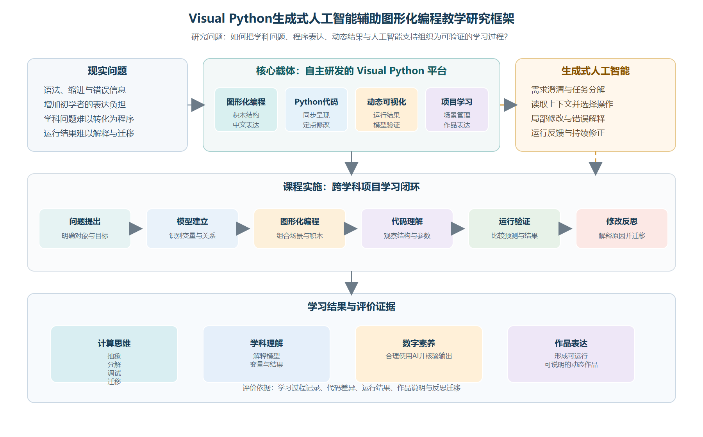
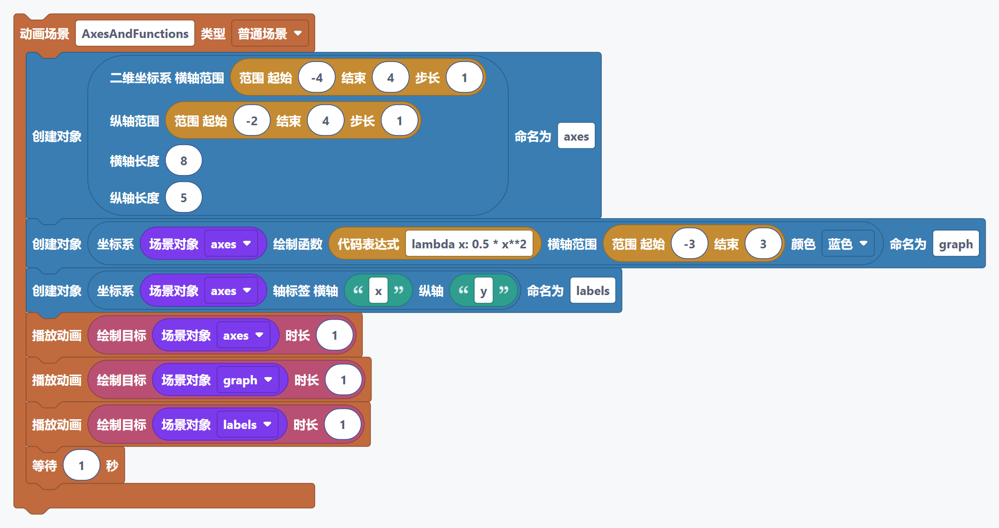
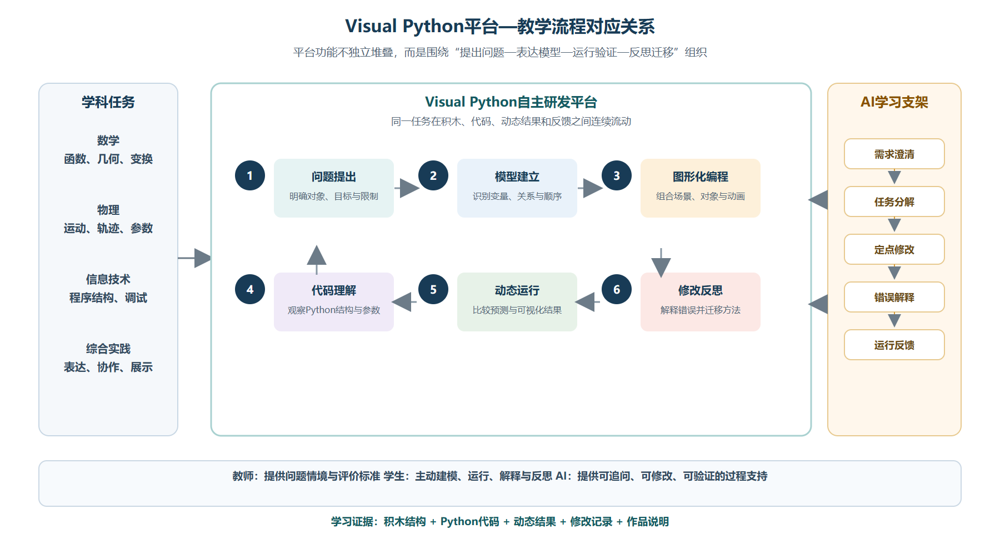
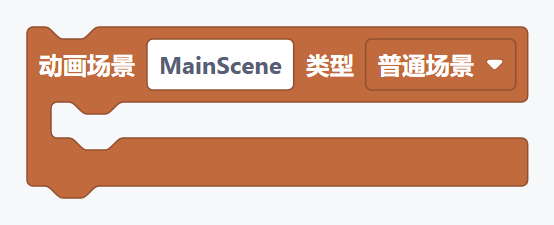
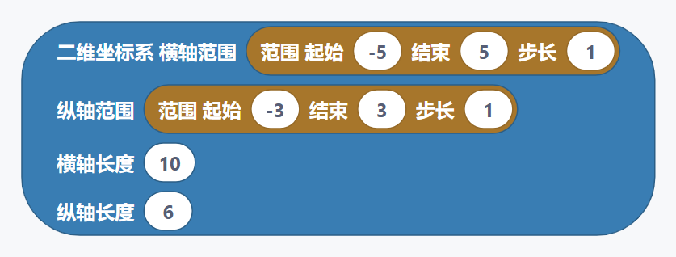
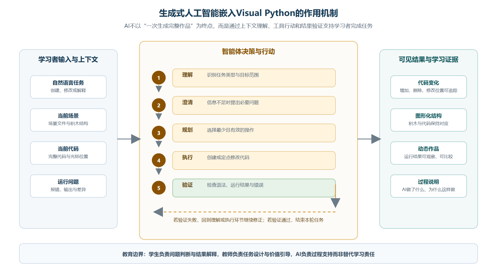

# 摘要

在人工智能快速进入学校教育的背景下，如何使人工智能真正服务于学生的思维发展，而不是替代学生完成学习任务，成为编程教育和数字化课程建设需要回应的重要问题。传统Python教学具有表达严谨、迁移性强等优点，但对初学者而言，语法规则、程序结构和运行错误往往形成较高的认知负担；单纯依靠图形化工具又容易停留在拖拽操作层面，难以促进学生理解程序背后的表达逻辑。针对这一矛盾，本文以自主研发的Visual Python平台为研究载体，探讨生成式人工智能辅助图形化编程教学的课程结构、学习流程和评价方式。

研究采用文献分析、设计研究和教学案例研究相结合的方法。在梳理建构主义、计算思维、动态表征和反馈学习等理论的基础上，分析Visual Python在图形化编程、Python代码、可视化作品和生成式人工智能之间建立联系的方式，提出“问题提出—模型建立—图形化编程—代码理解—运行验证—修改反思”的教学流程。文章进一步以高中阶段“抛体运动动态可视化”为完整案例，说明学生如何从学科问题出发建立变量关系，使用图形化积木形成程序结构，借助生成式人工智能完成定点修改和错误解释，并通过动画结果检验自己的理解。

研究认为，生成式人工智能的教育价值不在于一次性生成完整作品，而在于为学生提供可追问、可修改、可验证的学习支架；图形化编程的价值也不只是降低语法难度，而是把问题结构、程序结构和可视化结果放在同一学习环境中。Visual Python作为自主研发平台，能够支持学生在图形化积木、Python代码和动态作品之间往返转换，为跨学科项目学习提供较完整的学习环境。本文同时指出，人工智能辅助教学必须以学生的问题分析、结果判断和反思迁移为中心，平台不能代替教师的课程设计，也不能代替学生对模型和代码的理解。由于本文以平台设计和教学案例验证为主，尚未形成大样本、长周期的实证数据，相关结论仍需在不同学段和不同学科中进一步检验。

**关键词：** Visual Python；生成式人工智能；图形化编程；计算思维；动态表征；教学模式

# 一、研究背景与问题提出

## （一）数字化学习环境对编程教育提出的新要求

与此同时，学校课程越来越重视跨学科知识之间的联系。数学中的函数关系、物理中的运动规律、信息技术中的程序结构以及艺术中的动态表达，都可以通过程序化作品形成相互联系。学生如果只在纸面上学习公式和结论，往往难以观察变量变化所带来的连续结果；如果只操作现成软件，又可能看见了结果，却不理解结果是如何产生的。因此，编程学习环境需要在“可操作”和“可解释”之间建立平衡：一方面让学生能够较快形成作品，另一方面让学生有机会追问作品背后的模型和程序。

## （二）传统编程教学的学习困难

传统文本编程具有精确、开放和可迁移的特点，但初学者需要同时处理符号规则、缩进关系、变量命名、函数调用和错误信息。Kelleher和Pausch对初学者编程环境的研究表明，编程环境的设计会直接影响初学者能否把注意力放在问题解决上，而不是被表达工具本身阻断。^6^ Scratch等图形化学习研究也提示，工具形式会影响学生的学习投入。^2^ 在课堂中，学生常见的困难并不只是“不知道某个命令怎么写”，还包括以下几个层面。

第一，学生难以把学科问题转换为程序问题。例如，当教师提出“观察初速度改变后抛体轨迹如何变化”时，学生需要识别对象、变量、时间和运动关系，而不是直接寻找一段可以复制的代码。第二，学生难以理解程序的层次关系。场景、对象、动画、参数和运行顺序在文本中以连续字符呈现，初学者不容易看到它们之间的结构。第三，学生在运行失败后容易陷入反复试错。如果错误信息缺少解释，学生可能只会继续复制新的代码，而不会回到原来的模型和程序结构中检查问题。第四，学生完成一段程序后，常常把“能够运行”误认为“已经理解”，缺少对变量意义和结果合理性的说明。

## （三）生成式人工智能带来的新机遇与新问题

生成式人工智能能够根据自然语言生成文本、程序和解释，为编程教学提供了新的交互方式。学生可以用较自然的语言描述目标，获得程序结构建议，要求人工智能解释错误，或对已有代码进行局部修改。Kasneci等人指出，大型语言模型在教育中具有个性化反馈、学习支持和内容生成等潜力，但同时存在准确性、偏差、依赖和学习责任等问题。^9^ UNESCO也强调，生成式人工智能进入教育需要坚持以人为本、保护学习者权益，并建立适当的教师和学习者责任边界。^10^

由此看来，人工智能进入编程课堂并不等于让模型代替学生编程。真正值得研究的问题是：人工智能如何嵌入学生的思考过程，如何让生成结果成为可检查、可解释和可修改的对象，如何避免“输入一句话—复制一段代码—提交作品”的低水平学习。人工智能只有与任务分解、过程反馈和结果验证结合，才可能转化为促进计算思维发展的学习支架。

## （四）Visual Python平台的自主研发意义

Visual Python是本项目自主研发的图形化编程学习平台，面向Python程序设计、Manim可视化创作和生成式人工智能辅助学习进行持续建设。平台以积木式编程作为初学者的主要入口，同时保留完整代码编辑区域，使学生能够观察图形化表达与Python代码之间的对应关系。平台还提供工程管理、场景管理、运行输出、错误提示和AI编程助手等功能，使学习者可以在同一个环境中完成问题表达、程序编写、结果运行和作品修改。

这里的“自主研发”不仅意味着软件由项目团队自行开发，也意味着平台的积木分类、中文界面、代码生成规则、问题提示方式和AI交互流程都围绕教学任务进行设计。它不是把若干外部工具简单拼接在一起，而是尝试建立面向学习过程的功能关系。例如，图形化积木可以对应Python代码，代码的运行结果可以回到学习任务，AI助手可以读取当前代码和场景上下文，并以修改、解释和验证为主要方式参与学习。这样的设计使平台本身成为课程研究的一部分，而不只是课堂中被动使用的工具。

Visual Python的应用范围也不局限于数学。函数图像、几何图形、运动轨迹可以作为数学和物理学习内容；文字、图表、配音和动态场景可以用于信息技术、科学、艺术和综合实践活动。Manim是一种面向数学和科学动画的程序化表达工具，官方文档提供了场景、对象和动画等概念的说明。^11^ ^12^ ^13^ Visual Python将这类程序化表达转化为更适合初学者进入的图形化操作，同时允许学习者逐步过渡到代码理解。因此，本文关注的是面向跨学科学习的图形化编程环境，而不是某一个单独学科的软件教学。

## （五）研究问题与研究方法

本文围绕以下问题展开：

1. 如何利用Visual Python降低初学者进入Python编程的表达难度；
2. 如何把生成式人工智能嵌入图形化编程的学习过程，而不是只作为作品生成器；
3. 如何构建图形化编程、代码理解、可视化结果和学习评价相互衔接的教学模式；
4. 如何通过完整课堂案例检验该模式的可行性、教学价值与应用边界。

研究采用三种方法。第一，采用文献分析法，梳理建构主义、计算思维、动态表征、反馈和人工智能教育等相关研究。第二，采用设计研究法，根据真实学习困难设计平台功能和课程流程，并在持续迭代中分析设计是否回应教学问题。第三，采用教学案例研究法，以抛体运动动态可视化为案例，分析学生任务、平台操作、AI辅助和作品评价之间的关系。本文不虚构学生人数、前后测成绩或统计显著性，案例部分主要用于说明教学流程和形成过程性评价框架。

图1将研究对象、平台结构、AI作用、课程实施和学习评价放在同一逻辑链条中。图中Visual Python被定位为自主研发的学习平台，生成式人工智能则作为嵌入平台和课堂流程的学习支架。

# 二、理论基础与内在关联

## （一）建构主义与建造主义：从接受代码到生成作品

建构主义强调学习者在已有经验基础上主动建构意义，建造主义进一步强调学习者通过制作可公开讨论的作品来形成理解。Papert认为，计算机可以成为儿童建造和表达思想的媒介，学习者在制作过程中能够把抽象概念转化为可操作对象。^1^ 这一观点对图形化编程教学具有直接启发：课堂不能只让学生观看教师演示或记忆命令，而应让学生围绕一个有意义的问题制作、运行、修改和解释作品。

Visual Python中的场景、对象、动画和参数都可以成为学习对象。学生不需要一开始掌握完整的文本语法，但必须逐步回答“我想表达什么”“这个对象是什么”“哪些量会变化”“为什么要按这个顺序运行”等问题。积木的拖拽只是外在操作，真正的学习发生在学生将学科概念组织为程序结构的过程中。生成式人工智能可以在这个过程中提供提示，但作品的目标、变量意义和结果判断仍应由学生负责。

## （二）计算思维：从任务描述到程序结构

Wing将计算思维概括为一种面向问题、系统和过程的思考方式。^3^ Grover和Pea对K—12计算思维研究的综述表明，计算思维教育不仅涉及编程技能，也涉及抽象、算法、调试和迁移等能力。^4^ Weintrop等人进一步指出，在数学和科学课堂中，计算思维与建模、数据处理、模拟和动态系统探究之间存在联系。^5^

基于这些观点，本文不把“写出代码”作为唯一学习目标，而将学习过程拆分为四个可以观察的层次：

1. 关系识别：找出对象、变量、条件和变化关系；
2. 结构表达：用积木或代码组织输入、处理和输出；
3. 运行验证：观察程序结果是否符合问题模型；
4. 调试迁移：解释错误，修改结构，并将方法用于新的问题。

这四个层次与Visual Python的功能形成对应。图形化编程帮助学生建立结构表达，代码区帮助学生观察更精确的程序形式，运行输出帮助学生验证模型，AI助手则可以帮助学生解释错误和比较不同的实现方式。

## （三）多媒体学习与动态表征：让关系变化可见

数学和科学学习中的许多概念具有动态性，如函数参数变化、物体运动、几何变换和数据变化。静态图片可以呈现某一时刻的状态，却不一定能清楚呈现变化过程。Mayer的多媒体学习理论指出，学习者需要在文字、图像和过程之间建立有意义的联系，但多媒体信息也必须经过适当组织，否则会增加无关认知负担。^7^

## （四）反馈学习：从错误提示到修改行动

有效反馈不仅告诉学生“对”或“错”，还要帮助学生知道问题在哪里、为什么出现以及下一步可以做什么。Hattie和Timperley将反馈区分为任务层、过程层、自我调节层和自我层，并指出反馈的价值取决于它是否能够引导学习者采取进一步行动。^8^

在编程学习中，错误提示如果只有技术代码，初学者往往难以理解。Visual Python通过问题面板、代码位置和积木上下文提示，把错误转换为更容易行动的说明。AI助手则可以进一步解释错误原因、指出需要修改的位置、给出局部修改建议，并要求学生重新运行验证。这里的关键不是让AI生成更长的答案，而是让反馈指向下一步学习行动。

## （五）生成式人工智能作为学习支架

传统脚手架由教师根据学生当前水平提供提示、示例和反馈，生成式人工智能可以在一定程度上承担其中的部分任务，但不能自动拥有课堂目标、学科判断和教育责任。Kasneci等人提醒，语言模型产生的内容需要经过教师和学习者共同核验。^9^ UNESCO对生成式人工智能的指导也要求教育应用遵循安全、公平、适切和以人为本的原则。^10^ 相关人工智能教育研究也强调教师判断的重要性。^14^

因此，本文将AI助手定位为“可对话的程序学习支架”，而不是“自动完成作业的工具”。它应当支持以下行为：

1. 在需求含糊时帮助学生澄清目标；
2. 在任务复杂时帮助学生分解步骤；
3. 在已有作品上进行定点修改；
4. 解释运行错误和修改原因；
5. 鼓励学生比较、验证和反思生成结果。

## （六）理论之间的内在关联

由此形成本文的基本逻辑：学生从真实问题出发建立模型，通过图形化积木和代码表达模型，运行作品获得动态反馈，再借助教师和AI助手进行修改和解释，最后将形成的方法迁移到新的任务中。Visual Python把这一逻辑落实为可操作的学习环境，生成式人工智能则嵌入其中的分析、修改和反思环节。

图2所示的动画结果不是学习终点，而是学生判断模型和程序是否合理的外部证据。

图3进一步说明，平台功能并非彼此孤立，而是围绕学科任务在积木、代码、动态结果和反馈之间连续流动；教师、学生与AI分别承担情境引导、主动建模和过程支持的责任。

# 三、基于Visual Python平台的教学模式构建

## （一）平台设计定位

Visual Python的设计目标是为初学者提供一条从可视化操作走向程序理解的学习路径。平台保留图形化编程的直观性，也保留Python代码的完整表达能力；保留动画创作的开放性，也提供问题提示和运行反馈；保留AI生成内容的效率，也要求用户能够查看、修改和验证结果。

平台主要包含五个相互关联的部分：图形化编程区、代码编辑区、运行输出区、项目资源区和AI辅助区。图形化编程区负责组织对象和操作，代码编辑区负责呈现程序文本，运行输出区负责观察动画或错误，项目资源区负责管理场景和素材，AI辅助区负责对当前任务和代码进行对话式支持。

## （二）图形化编程与代码理解的衔接

积木式编程能够减少初学者在符号输入、括号匹配和缩进方面的困难，但不能成为代码学习的终点。Visual Python通过代码同步、代码定位和修改标记等方式，使学生能够看到积木操作所对应的Python表达。例如，学生拖入一个坐标轴积木，可以在代码区看到相应的对象创建语句；学生修改半径、颜色或位置，可以观察代码中的对应参数变化。

这种衔接有三个教育意义。第一，它使抽象的代码与可见的积木建立映射。第二，它使学生能够逐步认识变量、函数、参数和对象等概念。第三，它为AI辅助修改提供了明确对象：AI不必每次删除全部代码重写，而可以根据当前代码进行定点修改，学生也能够看到修改前后的差异。

## （三）生成式人工智能的嵌入方式

AI助手的课堂功能应围绕学习任务展开，而不是单独展示模型能力。学生提出请求后，AI首先判断请求是否清楚、当前代码是否存在、目标是新建作品还是修改已有作品；然后根据项目上下文给出简短计划或直接进行必要修改；修改后把结果反馈给学生，并在需要时建议运行验证。

AI交互可概括为以下闭环：

1. 识别当前场景和代码状态；
2. 判断任务属于创建、修改、解释还是调试；
3. 选择适合的操作方式；
4. 对代码进行局部修改或生成必要内容；
5. 展示修改结果和理由；
6. 根据运行结果继续修正或结束任务。

图6强调，AI助手的关键不在于输出更长的文本，而在于读取当前上下文、选择必要操作、展示可追踪的修改，并根据运行结果继续修正。这个过程使AI行为成为可以观察和讨论的学习过程。

## （四）“六环节”教学流程

为避免技术操作与学科目标脱节，本文构建“六环节”教学流程。

### 1. 问题提出

教师给出具有观察价值的问题，例如“改变发射角度后，抛体运动的最高点和水平距离如何变化”。问题需要具有明确的学科背景，同时保留可以探究的变量空间。

### 2. 模型建立

学生识别对象、变量和关系，确定哪些量保持不变，哪些量需要改变。教师不直接给出全部代码，而是帮助学生把问题转化为可表达的模型。

### 3. 图形化编程

学生选择场景、对象、参数和动画积木，按照程序运行顺序进行组合。此时关注重点是结构，而不是记忆完整语法。

### 4. 代码理解

学生观察代码区，找出变量、函数调用和参数位置。对于暂时不能理解的代码，可以通过注释、教师讲解或AI对话进行解释。

### 5. 运行验证

学生运行作品并观察结果，比较动画是否符合模型预期。如果结果异常，需要回到参数、对象和程序顺序中进行检查。

### 6. 修改反思

学生修改参数、动画效果或表达方式，说明修改的依据，并思考同一方法还能用于哪些问题。AI可以辅助修改，但学生需要说明自己是否接受AI建议以及为什么。

# 四、完整教学案例：抛体运动动态可视化

## （一）案例选择与学情分析

抛体运动适合作为综合案例，原因在于它同时包含物理规律、数学关系、坐标表示、变量控制和动态结果观察。学生可以先从生活中的投掷现象出发，再用坐标和参数描述运动，最后通过动画观察轨迹变化。该案例能够体现Visual Python的跨学科应用，也能避免把平台误解为只服务于数学函数绘图。

案例面向已经接触坐标、函数和基础运动知识的高中学生。学生不要求具备完整Python编程经验，但应能够理解变量、数值和简单关系式。初中阶段可以使用相同情境的简化版本，重点观察方向、轨迹和参数变化，不要求学生阅读全部代码。

## （二）教学目标

知识目标是理解抛体运动中初速度、发射角度、重力和时间之间的关系；能力目标是能够把运动问题分解为对象、参数、轨迹和动画过程，并用图形化积木建立基本程序；素养目标是形成根据运行结果检验模型、解释错误和迁移方法的意识；数字素养目标是能够合理使用生成式人工智能，识别生成内容的局限并对结果负责。

## （四）任务一：建立场景和坐标系

教师先展示一段简单动画：小球从某一点出发，沿曲线运动并留下轨迹。学生观察作品并回答：画面中有哪些对象？哪些量可能变化？坐标系的作用是什么？

学生在Visual Python中创建场景和坐标轴，加入小球对象。此时可使用场景积木、坐标轴积木、对象创建积木和播放动画积木。学生不需要一次完成全部效果，而是先保证场景可以运行。

课堂检查包括三点：场景是否存在，坐标轴是否清晰，小球是否能够正常出现。若运行失败，学生先查看问题面板和代码位置，再请求AI解释。AI的回答应尽量围绕当前代码，而不是直接生成全新的无关工程。

## （五）任务二：建立运动模型

学生根据已有物理知识确定初速度、发射角度、重力和时间等变量。教师引导学生区分“可以改变的参数”和“由模型计算得到的结果”。例如，初速度和角度可以作为探究变量，当前位置则随时间变化。

学生将变量通过图形化积木组织起来，并观察生成的Python代码。教师可选取一小段代码进行解释：变量保存什么信息，函数调用完成什么操作，参数改变会影响哪一个对象。代码阅读不追求逐字符讲解，而是强调程序结构与学科关系。

## （六）任务三：观察参数变化

学生分别改变初速度和发射角度，生成至少两组动画结果，并记录变化现象。建议学习单包含以下问题：

1. 哪个参数发生了变化；
2. 轨迹的哪一部分发生了变化；
3. 结果是否符合原来的判断；
4. 如果不符合，可能是模型、参数还是程序顺序出现问题。

这一环节体现动态表征的作用。学生不只得到一个静态答案，而是通过多次运行观察连续变化。教师应鼓励学生先作出预测，再使用程序验证，避免把运行结果当成无需解释的结论。

## （七）任务四：使用AI助手进行定点修改

学生提出具体请求，例如：“保留现有抛体运动模型，将小球改为红色，增加初速度和发射角度的文字说明，不要删除现有轨迹。”

AI助手需要读取当前场景和代码，识别这是对已有作品的局部修改，而不是重新创建工程。它应当修改对象颜色、文字内容和必要的布局代码，并保留原来的场景、变量与动画结构。学生通过代码区的差异显示查看增加和删除的内容，再运行作品验证修改是否符合要求。

如果学生提出“让动画更好看”这类不明确请求，AI不应立即生成大量代码，而应先询问画面风格、修改对象和希望保留的内容。学生可以选择“继续当前作品”“清空后重新设计”或“先查看修改建议”等方式。这样的交互把模糊需求转化为可以讨论的设计决策，也能减少学生在无目标试错中的时间。

## （八）任务五：错误分析与作品完善

学生可能遇到变量名称不一致、缩进错误、公式表达不完整或动画时间不合理等问题。教师要求学生先描述现象，再向AI提供必要上下文。AI可以给出错误原因、定位位置和局部修改方案，但学生必须重新运行并说明修改是否有效。

作品完善可以包括标题、参数说明、轨迹颜色、运动时间和旁白。配音不是必需项目，只有当学生希望把动画发展为讲解作品时才加入。这样可以防止课堂被装饰性功能占据，保持学科理解和程序设计的主线。

## （十）案例评价

| 表2 抛体运动案例评价表 | 优秀表现 | 达标表现 | 需要改进 |
|:--|:--|:--|:--|
| 模型理解 | 能说明变量关系并作出预测 | 能说明主要变量 | 不能区分对象与变量 |
| 积木结构 | 程序层次清楚，顺序合理 | 能完成基本连接 | 主要依靠试错连接 |
| 代码理解 | 能指出关键代码及其作用 | 能识别部分变量和参数 | 只会复制代码 |
| 运行验证 | 能根据结果主动修正模型 | 能发现明显错误 | 将运行结果直接当作结论 |
| 作品表达 | 动画清楚表达研究问题 | 动画基本完整 | 画面与问题关系不清 |
| AI使用 | 能提出具体需求并检查结果 | 能在提示下使用AI | 直接复制且无法解释 |

由于目前没有大样本课堂实验数据，本文不把上述评价表转换为虚构的百分比，而将其作为案例教学中的过程性评价工具。后续研究可在真实课堂中收集学生作品、对话记录和学习单，进一步建立量化评价指标。

# 五、教学模式的讨论

## （一）平台对学习过程的支持

Visual Python将程序结构、代码文本和可视化结果放在连续的学习链条中。学生在积木区进行操作，在代码区理解表达，在输出区观察结果，再回到积木或代码中修改。这一过程使“编程”从一次性输入变成可反复验证的学习活动。

从课程设计角度看，平台的自主研发意义体现在两个方面。一方面，项目团队可以根据学生在实际使用中遇到的困难调整积木、提示和交互，而不必完全受制于外部软件的固定结构；另一方面，平台的功能变化可以直接服务于教学研究，例如增加场景管理、代码差异、问题定位和AI上下文之后，就能够支持学生观察自己的修改过程。

## （二）图形化编程与代码学习的互补关系

图形化编程和文本代码不应被理解为互相替代的两种工具。对初学者而言，图形化积木提供了可见的语法结构和操作顺序；对进一步学习而言，代码提供了更开放的表达能力和迁移空间。Visual Python的教学设计应当允许学生根据学习目标在两者之间切换：初始阶段以积木建立结构，中间阶段观察代码对应关系，进阶阶段直接修改代码并回到可视化结果验证。

这种渐进关系能够回应图形化编程的一个常见问题：如果学生始终停留在拖拽层面，就可能缺少对程序表达的理解。因此，教学任务中应有意识地安排“看代码、说代码、改代码”的活动，而不是只要求“拼积木、出动画”。

## （三）生成式人工智能的教育边界

AI助手能够提高编程活动的反馈速度，但并不意味着它提供的每一个答案都是正确的。生成式人工智能可能误解任务、使用不适合当前项目的积木、修改范围过大或产生运行错误。教学中需要建立三个边界。

第一，目标边界：学生必须先说明学习问题，不能只提出“帮我做一个更酷的动画”。第二，过程边界：AI修改后学生必须查看差异并进行运行验证。第三，责任边界：作品是否正确、解释是否合理，最终由学生和教师共同判断，不能把责任转移给模型。

## （四）教师专业角色的变化

人工智能并没有削弱教师的价值，反而提高了教师进行任务设计和学习评价的要求。教师需要判断哪些内容应由学生独立完成，哪些内容可以使用AI支持；需要设计能够暴露学生理解过程的任务；还需要从作品结果和AI对话中识别学生是否真正理解。

在Visual Python课堂中，教师可以减少机械讲解语法的时间，把更多精力用于提出有层次的问题、组织同伴交流、解释学科概念和引导学生反思。教师的角色从“代码示范者”逐步扩展为“学习任务设计者、过程观察者和结果评价者”。

# 六、研究总结

## （一）主要结论

本文基于自主研发的Visual Python平台，研究生成式人工智能辅助图形化编程教学的可能形式。研究形成三点结论。

第一，图形化编程可以降低初学者进入Python程序设计的表达门槛，但其教育价值必须通过代码理解、运行验证和反思迁移来实现。只有把积木作为程序结构的可见表达，而不是作为命令图标，才能促进学生理解程序。

第二，生成式人工智能更适合作为学习支架，而不是自动完成作品的工具。需求澄清、任务分解、定点修改、错误解释和运行验证构成了比一次性代码生成更有教育意义的AI交互流程。学生对结果的判断和解释，是人工智能辅助学习不可缺少的环节。

第三，Visual Python作为自主研发的综合学习平台，能够连接图形化编程、Python代码、动态作品和AI辅助，具有支持跨学科项目学习的潜力。自主研发也便于根据课堂问题迭代功能。

## （二）研究创新

本文的创新主要体现在三个方面：一是把自主研发平台作为教育研究对象，关注平台结构与学习过程的关系；二是把生成式人工智能放入“提出问题—修改程序—验证结果”的完整学习闭环，而不是只讨论自动生成代码；三是以跨学科动态可视化案例说明图形化编程的课程价值，并建立过程、作品和AI使用相结合的评价框架。

## （三）研究局限与展望

本文目前以理论分析、平台设计和完整教学案例为主，尚未提供大样本、长周期和对照实验数据，因而不能直接断言该模式已经在所有学段取得稳定效果。后续研究应在真实课堂中收集不同年级学生的作品、修改记录、AI对话和学习反思，比较不同教学方式对计算思维、学科理解和学习投入的影响。

同时，还需要进一步研究AI生成内容的可解释性、学生依赖程度、教师评价标准和数据安全问题。只有在课程目标、教师指导、平台功能和评价制度共同完善的基础上，生成式人工智能才可能从“会生成内容”发展为“支持学生学习过程”的教育工具。

# 参考文献

1. Papert, S. *Mindstorms: Children, Computers, and Powerful Ideas*. New York: Basic Books, 1980.
2. Resnick, M., et al. Scratch: Programming for All. *Communications of the ACM*, 2009, 52(11): 60-67. DOI: 10.1145/1592761.1592779.
3. Wing, J. M. Computational Thinking. *Communications of the ACM*, 2006, 49(3): 33-35. DOI: 10.1145/1118178.1118215.
4. Grover, S., Pea, R. Computational Thinking in K-12: A Review of the State of the Field. *Educational Researcher*, 2013, 42(1): 38-43. DOI: 10.3102/0013189X12463051.
5. Weintrop, D., et al. Defining Computational Thinking for Mathematics and Science Classrooms. *Journal of Science Education and Technology*, 2016, 25: 127-147. DOI: 10.1007/s10956-015-9581-5.
6. Kelleher, C., Pausch, R. Lowering the Barriers to Programming: A Taxonomy of Programming Environments and Languages for Novice Programmers. *ACM Computing Surveys*, 2005, 37(2): 83-137. DOI: 10.1145/1089733.1089734.
7. Mayer, R. E. *Multimedia Learning*. 3rd ed. Cambridge: Cambridge University Press, 2021.
8. Hattie, J., Timperley, H. The Power of Feedback. *Review of Educational Research*, 2007, 77(1): 81-112. DOI: 10.3102/003465430298487.
9. Kasneci, E., et al. ChatGPT for Good? On Opportunities and Challenges of Large Language Models for Education. *Learning and Individual Differences*, 2023, 103: 102274. DOI: 10.1016/j.lindif.2023.102274.
10. UNESCO. *Guidance for Generative AI in Education and Research*. Paris: UNESCO, 2023. https://unesdoc.unesco.org/ark:/48223/pf0000386693.
11. Python Software Foundation. *Python 3 Documentation*. https://docs.python.org/3/ . Accessed 2026-07-31.
12. Blockly Developers. *Blockly Documentation*. Google for Developers. https://developers.google.com/blockly . Accessed 2026-07-31.
13. Manim Community. *Manim Community Documentation*. https://docs.manim.community/ . Accessed 2026-07-31.
14. Holmes, W., Bialik, M., Fadel, C. *Artificial Intelligence in Education: Promises and Implications for Teaching and Learning*. Boston: Center for Curriculum Redesign, 2019.
