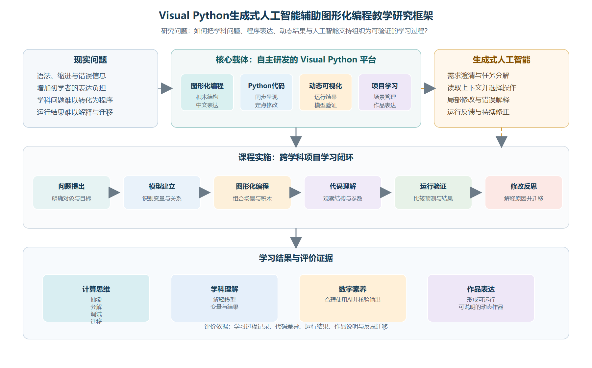
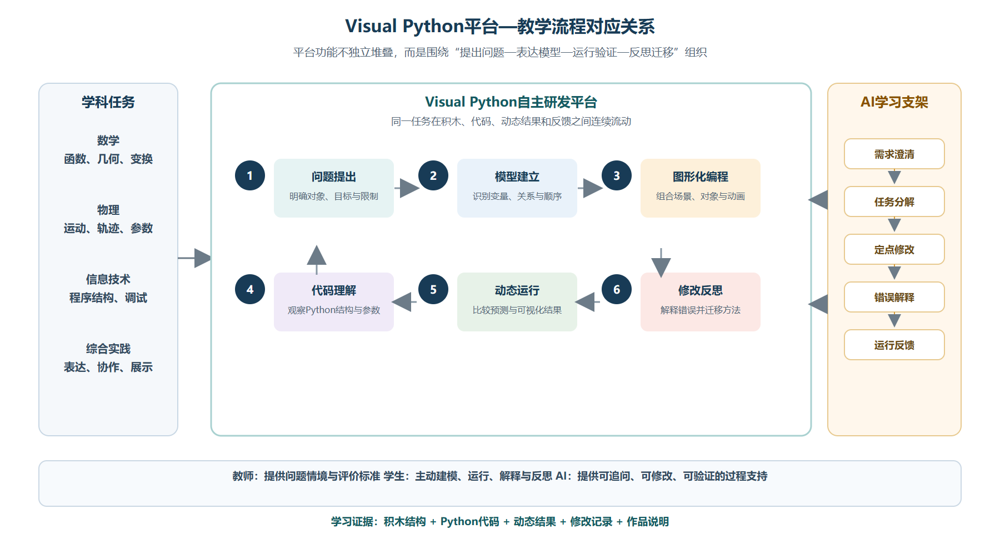
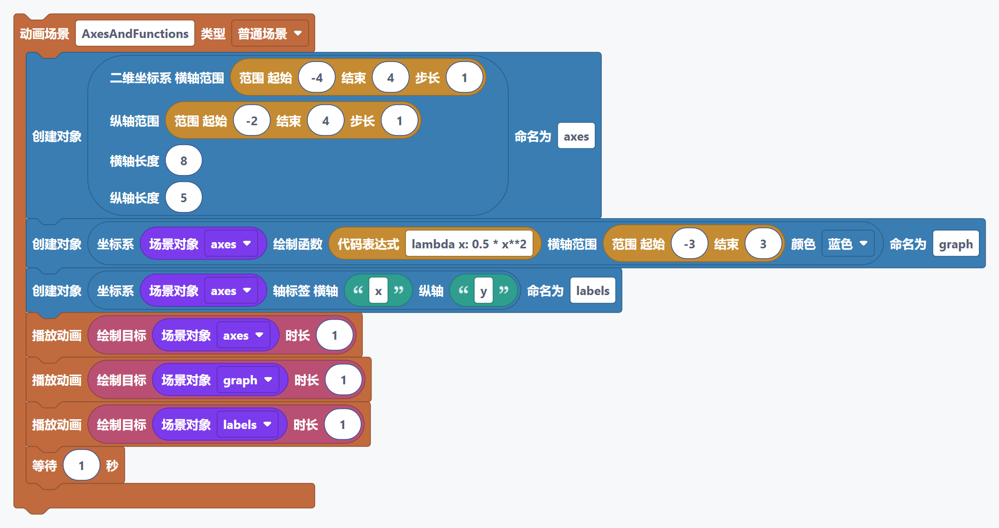
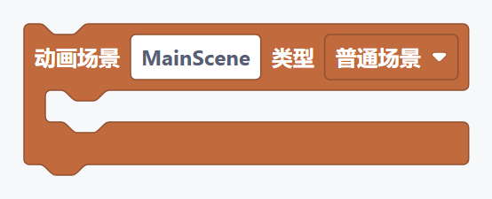
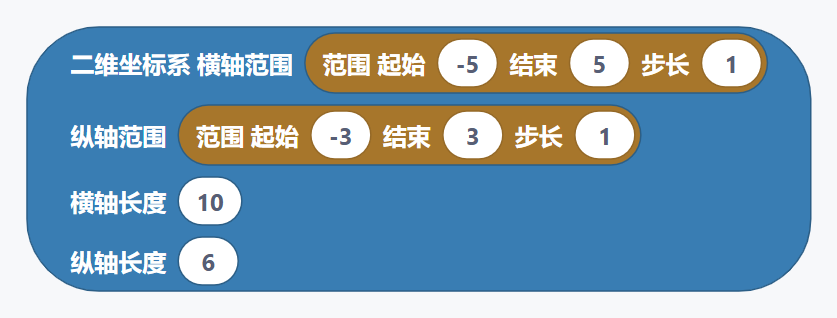
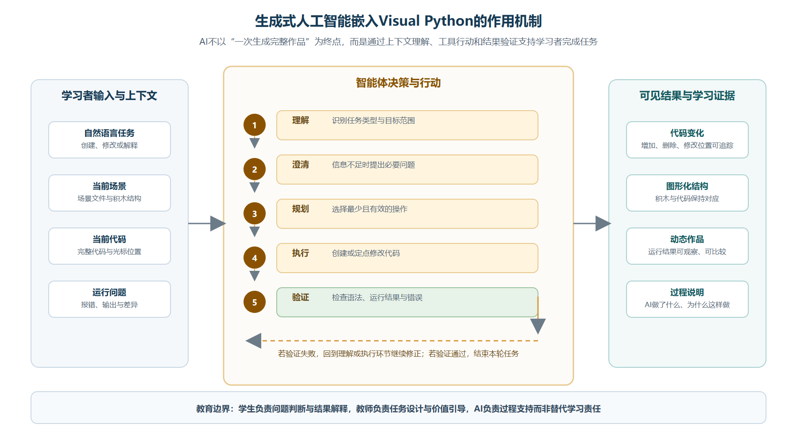

# 摘要

生成式人工智能正在改变编程学习的资源形态和交互方式，但人工智能能够生成程序，并不意味着学生已经理解程序。传统Python教学容易受到语法、缩进和错误调试的影响，单纯的图形化编程又可能停留在拖拽操作层面。本文以自主研发的Visual Python平台为载体，研究生成式人工智能辅助图形化编程教学的基本模式。研究采用文献分析、设计研究和教学案例研究方法，分析建构主义、计算思维、动态表征和反馈学习之间的关系，提出“问题提出—模型建立—图形化编程—代码理解—运行验证—修改反思”的教学流程。文章以高中抛体运动动态可视化为案例，说明学生如何使用图形化积木建立程序结构，观察Python代码，借助AI助手完成定点修改，并通过动画结果检验自己的模型。研究认为，人工智能的教学价值不在于替代学生完成作品，而在于提供需求澄清、错误解释、局部修改和过程反馈。Visual Python作为自主研发的综合学习平台，能够连接图形化积木、Python代码、动态作品和生成式人工智能，为数学、物理、信息技术等跨学科学习提供支持。本文不虚构大样本实验数据，主要从教学设计和案例实践角度讨论模式的可行性及其边界。

**关键词：** Visual Python；生成式人工智能；图形化编程；计算思维；教学模式

# 一、研究背景与问题提出

## （一）编程教育的新要求

计算思维不仅是编写程序的技能，也包含问题分解、抽象建模、算法设计、调试和迁移等能力。Wing指出，计算思维是面向问题和过程的一般思维方式。^3^ Grover和Pea的研究也表明，K—12阶段的计算思维教育应超越语法训练，关注问题解决和概念理解。^4^ 在数学、物理和信息技术学习中，学生需要把变量关系、运动过程和算法步骤转化为可观察、可验证的动态结果。

传统Python学习具有开放性和迁移性，但初学者往往同时面对语法、缩进、变量和错误信息等困难。Kelleher和Pausch指出，编程环境的设计会影响初学者能否把注意力放在问题解决上。^6^ Scratch等图形化工具降低了符号输入门槛，但图形化操作如果缺少代码理解和结果解释，也容易形成“会拼积木、不会说明程序”的问题。^2^

## （二）生成式人工智能的教育价值与边界

生成式人工智能能够根据自然语言生成程序、解释错误和提出修改建议。Kasneci等人认为，大型语言模型可以提供个性化支持，但其内容准确性、学习依赖和责任边界必须受到重视。^9^ UNESCO也要求生成式人工智能教育应用坚持以人为本，并建立教师和学习者的责任边界。^10^

因此，AI不应成为自动完成作业的工具，而应成为学生可追问、可检查和可修改的学习支架。学生需要先明确问题，AI再根据当前项目进行辅助；AI完成修改后，学生仍需查看代码差异并运行验证。

## （三）Visual Python平台的研究定位

Visual Python是本项目自主研发的图形化编程学习平台，支持Python程序设计、Manim动态可视化、工程管理、代码编辑、运行输出和AI辅助编程。平台以图形化积木降低初学者的表达难度，同时保留Python代码区，帮助学生理解积木和程序之间的对应关系。Manim官方文档将场景、对象和动画作为程序化表达的重要概念。^13^ Visual Python则将这些概念转化为更适合初学者操作的学习环境。

平台并不局限于数学。函数和几何可以用于数学学习，运动轨迹可以用于物理学习，数据和算法过程可以用于信息技术和科学课程，文字、配音和动画也可以用于综合实践活动。Python官方文档、Blockly开发文档和Manim文档分别提供了程序语言、积木式表达和动态动画的基础资料。^11^ ^12^ ^13^ 相关人工智能教育研究也强调教师判断的重要性。^14^ 本文重点研究平台如何服务于教学过程，而非单纯介绍软件功能。

## （四）研究问题与方法

本文关注四个问题：如何降低初学者的编程表达难度；如何把生成式人工智能嵌入图形化编程过程；如何连接积木、代码、动画和评价；如何通过完整案例验证教学模式的可行性。研究采用文献分析、设计研究和教学案例研究方法，不虚构课堂样本和统计结果，以平台设计、任务流程和作品评价作为主要证据。

图1呈现本文的总体研究逻辑：以自主研发的Visual Python为平台载体，把生成式人工智能嵌入跨学科项目学习，并通过代码、动态结果和过程评价检验学习成效。

# 二、理论基础与教学逻辑

## （一）建构主义与建造主义

建构主义强调学习者主动形成知识，Papert的建造主义则进一步强调通过制作作品表达和检验理解。^1^ 在Visual Python课堂中，学生不是先学习全部语法再开始创作，而是从一个真实问题出发，逐步确定对象、变量、操作顺序和结果。积木是可见的程序结构，动画是可观察的学习证据，AI则提供解释和修改建议。

## （二）计算思维与动态表征

Weintrop等人指出，数学和科学课堂中的计算思维与建模、模拟、数据处理和动态系统探究具有联系。^5^ 学生改变变量、运行程序并观察轨迹变化，实际上是在进行“预测—表达—运行—比较—修正”的循环。Mayer的多媒体学习理论说明，文字、图像和过程只有经过合理组织，才能支持学习而不是增加无关认知负担。^7^

## （三）反馈与人工智能支架

Hattie和Timperley指出，有效反馈应指向问题、过程和下一步行动。^8^ 因此，Visual Python中的问题面板和代码定位不应只显示错误信息，还应帮助学生知道问题在哪里、可能原因是什么以及下一步可以做什么。AI助手可进一步解释错误、提出局部修改方案，并要求学生重新运行验证。

上述理论形成如下教学逻辑：学生从真实问题出发建立模型，用图形化积木表达模型，在代码区理解程序，在输出区观察动态结果，根据反馈修改程序，最后把方法迁移到新任务中。

图2说明，Visual Python的平台功能围绕教学任务形成连续链条，学生在积木、代码、动态结果和反馈之间往返，而不是分别学习彼此割裂的功能。

# 三、教学模式构建

## （一）平台功能与教学作用

Visual Python由图形化编程区、代码编辑区、运行输出区、工程资源区和AI辅助区组成。图形化编程区帮助学生建立程序结构，代码区帮助学生理解变量和函数，运行输出区帮助学生检验模型，工程资源区支持多场景和素材管理，AI辅助区支持需求澄清、代码修改和错误分析。

图形化编程和代码学习应当互相衔接。学生拖入坐标轴、对象或动画积木后，可以在代码区查看对应Python表达；学生修改参数后，可以观察代码和动画的同步变化。这样既降低了入门难度，也避免学生长期停留在纯拖拽层面。

## （二）教学流程

### 1. 问题提出

教师提出具有学科背景和探究空间的问题，学生明确研究对象和变化变量。

### 2. 模型建立

学生分析对象、参数、时间和关系，形成可以表达的模型。

### 3. 图形化编程

学生组合场景、对象、参数和动画积木，关注程序结构和运行顺序。

### 4. 代码理解

学生观察代码中的变量、函数和参数位置，必要时寻求教师或AI解释。

### 5. 运行验证

学生观察动画结果，比较结果是否符合原来的预测。

### 6. 修改反思

学生根据结果修改程序，说明修改依据，并尝试迁移到新的问题。

## （三）生成式人工智能的课堂角色

AI助手主要完成五类工作：需求澄清、任务分解、定点修改、错误解释和运行反馈。它需要读取当前工程和代码，判断任务是创建、修改、解释还是调试，再采取相应行动。AI修改已有作品时，应保留原有结构，避免删除全部代码重写；学生则需要查看差异、运行验证并对结果负责。

图6将AI的工作过程呈现为“理解—澄清—规划—执行—验证”的循环，并将代码变化、图形化结构、动态作品和过程说明作为可观察的学习证据。

| 表1 教师、学生与AI的角色分工 | 主要责任 |
|:--|:--|
| 教师 | 设计任务、讲解概念、组织讨论、评价成果 |
| 学生 | 分析问题、组合程序、验证结果、解释作品 |
| AI助手 | 澄清需求、解释错误、辅助修改、提供反馈 |
| Visual Python | 提供积木、代码、运行和作品管理环境 |

# 四、完整教学案例：抛体运动动态可视化

## （一）案例目标

抛体运动同时包含物理规律、数学关系、坐标表示、参数控制和动画观察，适合用于跨学科图形化编程学习。案例面向已经接触坐标、函数和基础运动知识的高中学生。初中版本可以减少参数和公式，重点观察方向、轨迹和结果变化。

学生需要理解初速度、发射角度、重力和时间等变量，使用图形化积木建立场景和运动对象，观察Python代码，改变参数并解释动画结果。最终作品应能够说明研究问题，而不是只追求复杂画面。

## （二）教学过程

### 1. 建立场景

教师展示小球沿曲线运动的动画，学生讨论对象、变量和坐标系的作用。学生在Visual Python中创建场景、坐标轴和小球，先保证基础场景可以运行。

### 2. 建立模型

学生区分可改变参数和计算结果，使用积木表达初速度、角度、重力和时间。教师选取一段生成的Python代码，帮助学生认识变量、函数调用和参数。

### 3. 观察变化

学生改变初速度和发射角度，形成至少两组结果，并回答：改变了什么，轨迹哪里改变，结果是否符合预测，若不符合应检查什么。

### 4. AI辅助修改

学生提出具体请求，例如：“保留现有轨迹，将小球改为红色，增加初速度和发射角度说明，不删除已有场景。”AI根据当前代码进行定点修改，学生通过差异显示查看修改内容，再运行验证。如果学生只提出“让动画更好看”，AI应先询问对象、风格和保留内容，避免直接生成无关代码。

### 5. 错误分析与展示

学生根据问题面板和代码位置描述错误，再请求AI解释原因。AI给出局部修改建议后，学生重新运行并说明修改是否有效。展示时，学生需要说明模型、变量、程序结构、AI帮助以及最终判断依据。

## （三）案例评价

| 表2 抛体运动案例评价表 | 主要观察内容 |
|:--|:--|
| 模型理解 | 能否说明对象、变量和变化关系 |
| 程序结构 | 积木和代码顺序是否合理 |
| 运行验证 | 能否根据结果发现并修正问题 |
| 作品表达 | 动画是否清楚表达学习内容 |
| 反思迁移 | 能否解释修改原因并迁移方法 |
| AI使用 | 能否提出需求、检查结果并承担判断责任 |

本文不把案例过程虚构为大样本实验，而是将评价表作为真实课堂可使用的过程性工具。后续可收集学生作品、学习单、AI对话和版本差异，进一步开展量化研究。

# 五、讨论与研究总结

## （一）教学价值

Visual Python把积木、代码和动态结果连接起来，使学生能够在同一环境中完成表达、运行和修改。图形化编程降低了输入门槛，代码区支持程序理解，动画结果提供模型反馈，AI助手则提供过程性支架。四者结合后，编程学习不再只是记忆命令，而成为分析问题、建立模型、验证结果和反思迁移的学习活动。

## （二）AI使用边界

AI能够提高反馈速度，但仍可能误解任务、调用不合适的积木或产生错误代码。学生必须先明确目标，再检查修改内容并运行验证。教师需要制定AI使用规则，防止学生把生成结果直接当作答案。人工智能教育研究和UNESCO指南都强调了准确性、责任和学习者主体性问题。^9^ ^10^

## （三）研究结论

本文认为，基于Visual Python平台的生成式人工智能辅助图形化编程教学具有三个特点：第一，平台的自主研发使积木、代码、运行输出和AI交互能够围绕教学问题持续迭代；第二，图形化编程与代码学习可以形成由浅入深的连续路径；第三，AI只有嵌入需求澄清、局部修改、错误解释和运行验证过程，才可能真正支持计算思维发展。

Visual Python的应用范围不局限于数学，也可以服务于物理、信息技术、科学和综合实践活动。本文的局限在于尚未提供大样本、长周期和对照实验数据，后续需要在不同学段和学科中开展实证研究，并进一步关注学生依赖、教师培训和数据安全问题。

# 参考文献

1. Papert, S. *Mindstorms: Children, Computers, and Powerful Ideas*. New York: Basic Books, 1980.
2. Resnick, M., et al. Scratch: Programming for All. *Communications of the ACM*, 2009, 52(11): 60-67. DOI: 10.1145/1592761.1592779.
3. Wing, J. M. Computational Thinking. *Communications of the ACM*, 2006, 49(3): 33-35. DOI: 10.1145/1118178.1118215.
4. Grover, S., Pea, R. Computational Thinking in K-12: A Review of the State of the Field. *Educational Researcher*, 2013, 42(1): 38-43. DOI: 10.3102/0013189X12463051.
5. Weintrop, D., et al. Defining Computational Thinking for Mathematics and Science Classrooms. *Journal of Science Education and Technology*, 2016, 25: 127-147. DOI: 10.1007/s10956-015-9581-5.
6. Kelleher, C., Pausch, R. Lowering the Barriers to Programming: A Taxonomy of Programming Environments and Languages for Novice Programmers. *ACM Computing Surveys*, 2005, 37(2): 83-137. DOI: 10.1145/1089733.1089734.
7. Mayer, R. E. *Multimedia Learning*. 3rd ed. Cambridge: Cambridge University Press, 2021.
8. Hattie, J., Timperley, H. The Power of Feedback. *Review of Educational Research*, 2007, 77(1): 81-112. DOI: 10.3102/003465430298487.
9. Kasneci, E., et al. ChatGPT for Good? On Opportunities and Challenges of Large Language Models for Education. *Learning and Individual Differences*, 2023, 103: 102274. DOI: 10.1016/j.lindif.2023.102274.
10. UNESCO. *Guidance for Generative AI in Education and Research*. Paris: UNESCO, 2023. https://unesdoc.unesco.org/ark:/48223/pf0000386693.
11. Python Software Foundation. *Python 3 Documentation*. https://docs.python.org/3/ . Accessed 2026-07-31.
12. Blockly Developers. *Blockly Documentation*. Google for Developers. https://developers.google.com/blockly . Accessed 2026-07-31.
13. Manim Community. *Manim Community Documentation*. https://docs.manim.community/ . Accessed 2026-07-31.
14. Holmes, W., Bialik, M., Fadel, C. *Artificial Intelligence in Education: Promises and Implications for Teaching and Learning*. Boston: Center for Curriculum Redesign, 2019.
