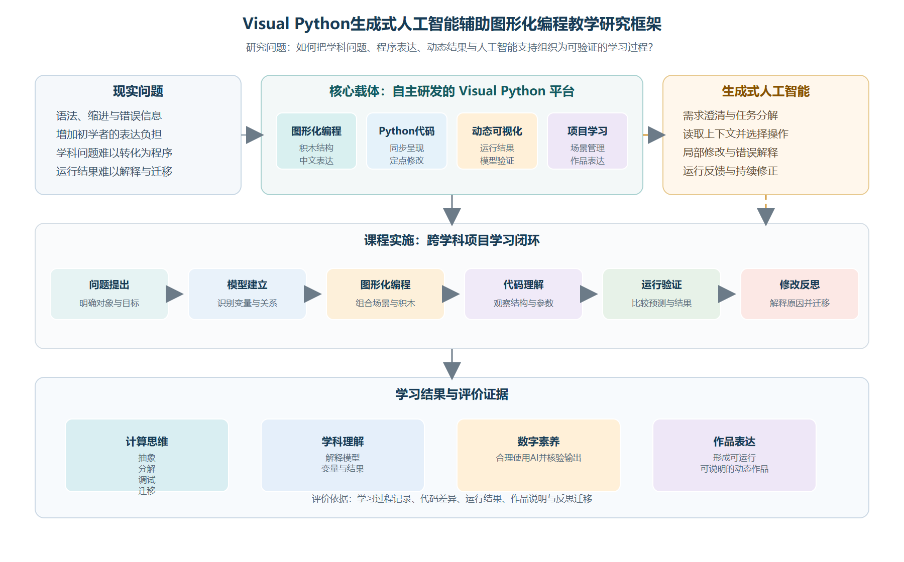
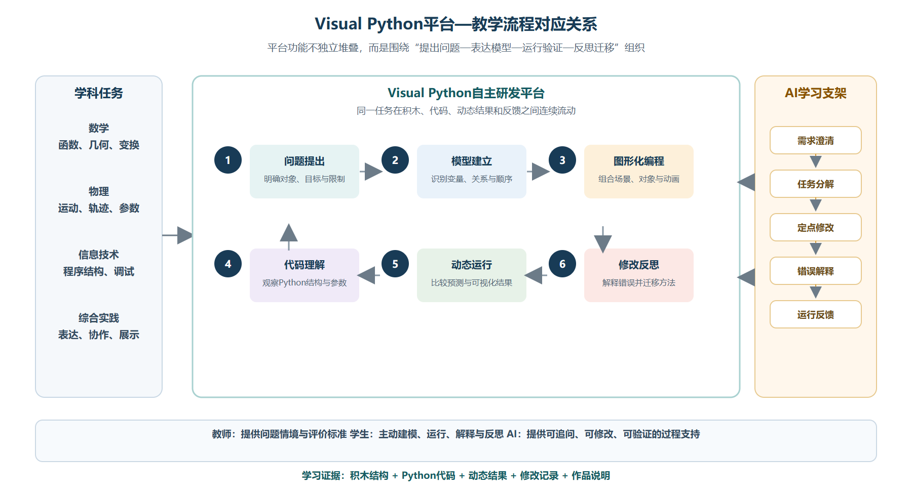
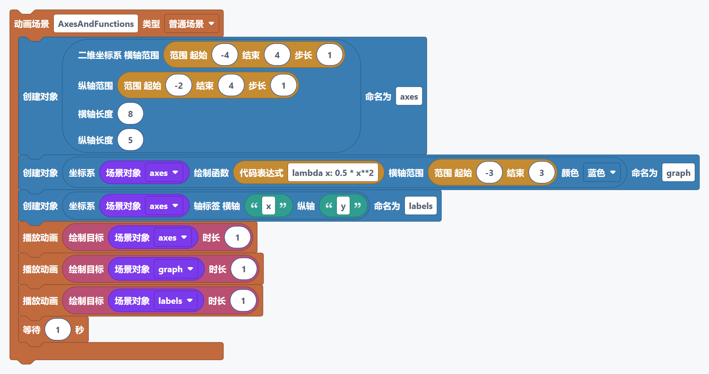
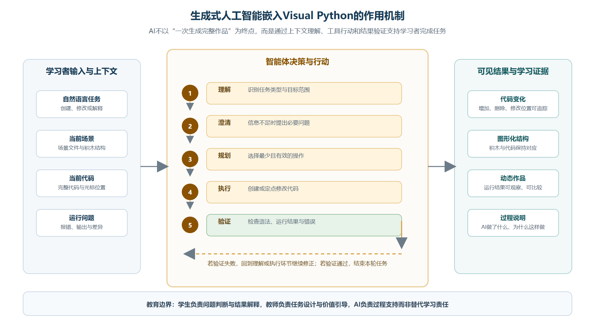
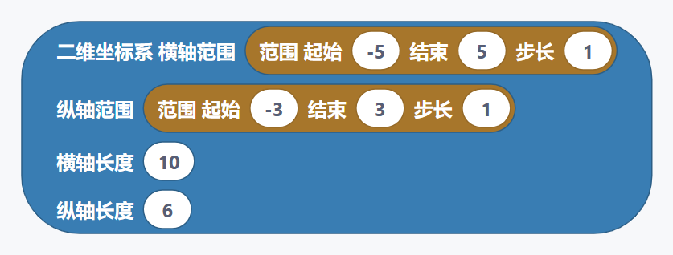

# 摘要

生成式人工智能为编程学习提供了新的交互方式，但程序自动生成不能替代学生对问题、模型和结果的理解。本文以自主研发的Visual Python平台为研究载体，探讨生成式人工智能辅助图形化编程教学的基本流程。研究采用文献分析和教学案例研究方法，提出“问题提出—模型建立—图形化编程—代码理解—运行验证—修改反思”的教学流程，并以高中抛体运动动态可视化为案例，说明学生如何使用图形化积木建立程序结构，观察Python代码，借助AI助手完成定点修改，再通过动画结果检验模型。研究认为，Visual Python能够连接积木、代码和动态作品，生成式人工智能适合承担需求澄清、错误解释和局部修改等学习支架功能。平台的自主研发使其可以根据课堂需要持续调整积木、代码提示、运行反馈和AI交互流程。本文不虚构大样本实验数据，主要从教学设计和案例实践角度讨论该模式的价值与边界。

**关键词：** Visual Python；生成式人工智能；图形化编程；计算思维；教学模式

# 一、研究背景与理论基础

人工智能和数字化工具正在改变学校编程教育。编程学习的目标不应只是记忆语法，而应包括问题分解、抽象建模、算法设计、调试和迁移。Wing指出，计算思维是一种面向问题和过程的一般思维方式。^3^ Grover和Pea的研究也表明，基础教育中的计算思维应关注概念理解和问题解决，而不仅是语法训练；数学和科学课堂中的计算思维还与建模和模拟有关。^4^ ^5^

传统Python教学表达能力强，但初学者容易受到语法、缩进、变量和错误信息的影响。图形化编程可以降低符号输入门槛，Scratch研究和初学者编程环境研究均说明，工具的表达方式会影响学生能否把注意力放在问题解决上。^2^ ^6^ 但如果学生只会拖拽积木而不能解释代码和结果，图形化编程也可能停留在表层操作。

生成式人工智能可以生成程序、解释错误和提供修改建议，但模型输出仍需人工检查。Kasneci等人指出，大型语言模型既有个性化支持价值，也存在准确性和学习依赖问题。^9^ UNESCO要求生成式人工智能教育应用坚持以人为本，并明确教师和学习者的责任边界。^10^ 因此，AI应成为学生可以追问、检查和修改的学习支架，而不能成为自动完成作业的工具。

Visual Python是本项目自主研发的图形化编程学习平台，支持Python、Manim动态可视化、工程管理、代码编辑、运行输出和AI辅助编程。平台把图形化积木作为入口，同时保留代码区，使学生能够观察积木操作对应的Python表达；运行输出则把程序结构转化为可观察的动画结果。Python、Blockly和Manim官方文档分别为语言、积木式表达和程序化动画提供了基础资料。^11^ ^12^ ^13^ Visual Python的应用范围不限于数学，也可以支持物理、信息技术、科学和综合实践活动。

图1呈现本文的总体研究逻辑：以自主研发的Visual Python为平台载体，把生成式人工智能嵌入跨学科项目学习，并通过代码、动态结果和过程评价检验学习成效。

# 二、教学模式构建

## （一）基本流程

Visual Python教学模式包括六个环节：

1. 问题提出：教师给出具有学科背景和探究空间的问题；
2. 模型建立：学生识别对象、变量和变化关系；
3. 图形化编程：学生组合场景、对象、参数和动画积木；
4. 代码理解：学生观察变量、函数和参数在代码中的位置；
5. 运行验证：学生根据动画结果判断模型是否合理；
6. 修改反思：学生修正程序并把方法迁移到新任务。

这一流程体现了建构主义和建造主义关于“通过制作形成理解”的观点。^1^ 动态结果不是学习终点，而是学生检验模型的外部证据。Mayer的多媒体学习理论说明，文字、图像和过程需要经过合理组织，才能支持概念理解。^7^ 反馈还应指向下一步行动，而不是只显示“正确”或“错误”。^8^

图2说明，Visual Python的平台功能围绕教学任务形成连续链条，学生在积木、代码、动态结果和反馈之间往返，而不是分别学习彼此割裂的功能。

## （二）AI助手的课堂作用

AI助手主要承担需求澄清、任务分解、定点修改、错误解释和结果反馈五类工作。学生提出“保留当前轨迹，将小球改为红色并增加参数说明”时，AI应读取当前代码，仅修改相关内容，而不是删除全部作品重写。学生应通过差异显示查看修改，并重新运行验证。对于“让动画更好看”这类模糊请求，AI应先询问修改对象和保留内容。

图4将AI的工作过程呈现为“理解—澄清—规划—执行—验证”的循环，并将代码变化、图形化结构、动态作品和过程说明作为可观察的学习证据。

| 表1 课堂参与者的角色 | 主要责任 |
|:--|:--|
| 教师 | 设计任务、讲解概念、组织讨论、评价成果 |
| 学生 | 分析问题、组合程序、验证结果、解释作品 |
| AI助手 | 澄清需求、解释错误、辅助修改、提供反馈 |
| Visual Python | 提供积木、代码、运行和作品管理环境 |

# 三、教学案例：抛体运动动态可视化

## （一）案例设计

抛体运动同时包含物理规律、数学关系、坐标表示、参数控制和动态结果观察，适合用于跨学科图形化编程学习。高中学生需要理解初速度、发射角度、重力和时间等变量，使用Visual Python创建坐标系和运动对象，改变参数并比较轨迹结果。初中版本可以减少公式和变量，重点观察方向、轨迹和结果变化。

## （二）案例过程

教师先展示小球沿曲线运动的动画，学生讨论对象、变量和坐标系的作用。随后学生创建场景、坐标轴和小球，使用积木建立运动结构，并观察生成的Python代码。学生改变初速度和角度，记录轨迹变化，判断结果是否符合预测。

在作品完善阶段，学生向AI提出具体修改需求。AI根据当前工程进行局部修改，学生查看代码变化并运行验证。如果出现变量错误、缩进错误或动画时间不合理，学生先描述现象，再请求AI解释原因。最终展示时，学生说明研究问题、变量含义、程序结构、AI帮助和自己的判断依据。

## （三）案例评价

| 表2 抛体运动案例评价维度 | 评价重点 |
|:--|:--|
| 模型理解 | 能否说明对象、变量和变化关系 |
| 程序结构 | 积木和代码顺序是否合理 |
| 运行验证 | 能否根据结果发现并修正问题 |
| 作品表达 | 动画是否清楚表达学习内容 |
| AI使用 | 能否提出需求、检查结果并承担判断责任 |

本文将案例作为教学设计和过程性评价的验证，不虚构大样本实验数据。后续可通过学生作品、学习单、AI对话和版本差异开展实证研究。

# 四、研究结论

基于Visual Python平台的生成式人工智能辅助图形化编程教学具有三点价值。第一，图形化积木降低了初学者的表达门槛，代码区又为学生理解Python提供了过渡路径。第二，动态作品把抽象关系转化为可观察结果，支持学生进行预测、验证和修正。第三，生成式人工智能只有嵌入需求澄清、局部修改、错误解释和运行验证过程，才可能成为促进计算思维发展的学习支架。

Visual Python作为自主研发平台，能够根据教学问题持续调整积木设计、中文界面、代码生成、问题提示和AI交互流程，因而具有支持多学科项目学习的潜力。相关人工智能教育研究同样强调教师判断和学习者责任。^14^ 其局限在于仍需更多真实课堂数据检验，不同学段的任务难度、教师培训和AI使用边界也需要继续研究。

从课堂实施看，教师应先确定学科目标，再选择是否使用图形化积木、代码编辑或AI辅助。对于初学者，任务可以从对象创建和参数观察开始；对于有一定基础的学生，则可以增加代码解释、程序调试和跨学科作品设计。评价时应同时关注结果和过程，既看动画是否正确，也看学生能否说明变量关系、解释修改原因，并对AI生成内容作出独立判断。只有这样，平台和AI才不会把学习简化为作品输出，而能够支持学生形成可迁移的问题解决方法。

# 参考文献

1. Papert, S. *Mindstorms: Children, Computers, and Powerful Ideas*. New York: Basic Books, 1980.
2. Resnick, M., et al. Scratch: Programming for All. *Communications of the ACM*, 2009, 52(11): 60-67. DOI: 10.1145/1592761.1592779.
3. Wing, J. M. Computational Thinking. *Communications of the ACM*, 2006, 49(3): 33-35. DOI: 10.1145/1118178.1118215.
4. Grover, S., Pea, R. Computational Thinking in K-12: A Review of the State of the Field. *Educational Researcher*, 2013, 42(1): 38-43. DOI: 10.3102/0013189X12463051.
5. Weintrop, D., et al. Defining Computational Thinking for Mathematics and Science Classrooms. *Journal of Science Education and Technology*, 2016, 25: 127-147. DOI: 10.1007/s10956-015-9581-5.
6. Kelleher, C., Pausch, R. Lowering the Barriers to Programming: A Taxonomy of Programming Environments and Languages for Novice Programmers. *ACM Computing Surveys*, 2005, 37(2): 83-137. DOI: 10.1145/1089733.1089734.
7. Mayer, R. E. *Multimedia Learning*. 3rd ed. Cambridge: Cambridge University Press, 2021.
8. Hattie, J., Timperley, H. The Power of Feedback. *Review of Educational Research*, 2007, 77(1): 81-112. DOI: 10.3102/003465430298487.
9. Kasneci, E., et al. ChatGPT for Good? On Opportunities and Challenges of Large Language Models for Education. *Learning and Individual Differences*, 2023, 103: 102274. DOI: 10.1016/j.lindif.2023.102274.
10. UNESCO. *Guidance for Generative AI in Education and Research*. Paris: UNESCO, 2023. https://unesdoc.unesco.org/ark:/48223/pf0000386693.
11. Python Software Foundation. *Python 3 Documentation*. https://docs.python.org/3/ . Accessed 2026-07-31.
12. Blockly Developers. *Blockly Documentation*. Google for Developers. https://developers.google.com/blockly . Accessed 2026-07-31.
13. Manim Community. *Manim Community Documentation*. https://docs.manim.community/ . Accessed 2026-07-31.
14. Holmes, W., Bialik, M., Fadel, C. *Artificial Intelligence in Education: Promises and Implications for Teaching and Learning*. Boston: Center for Curriculum Redesign, 2019.
